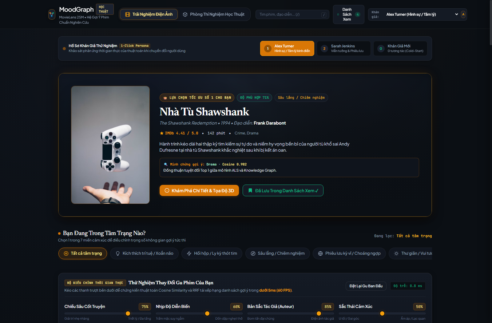
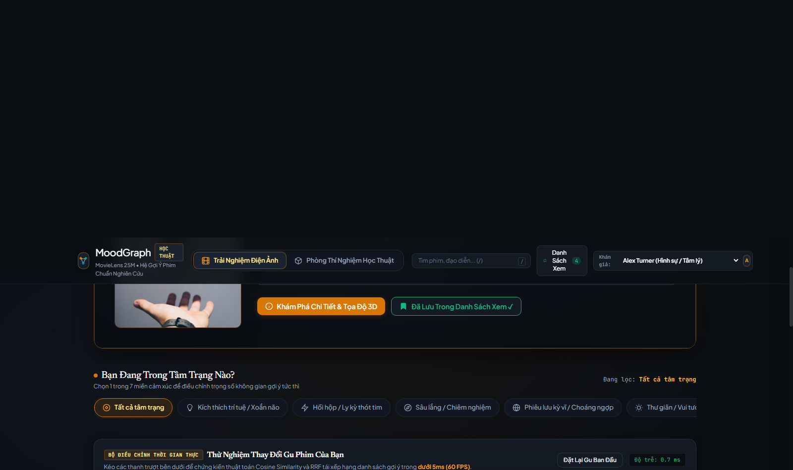
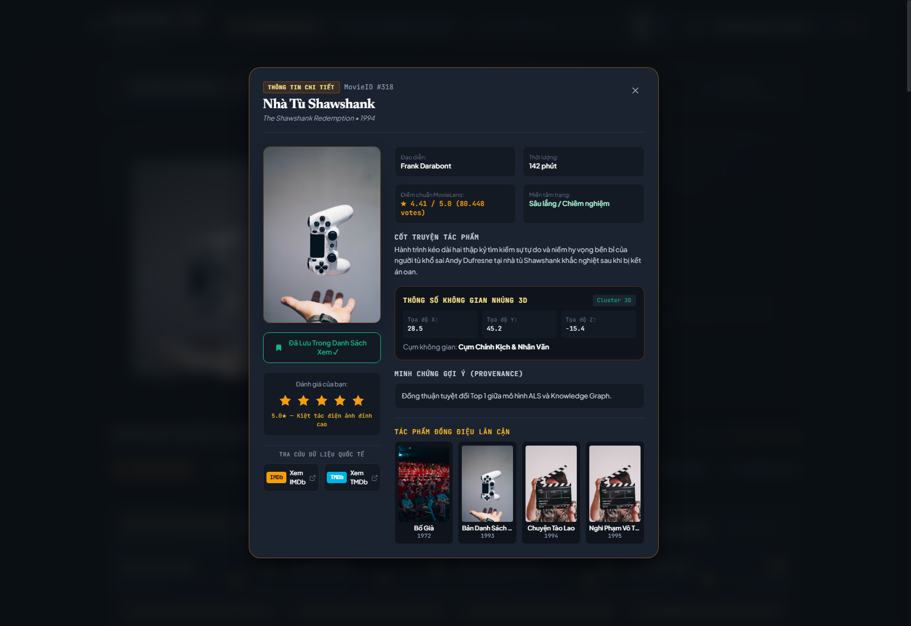
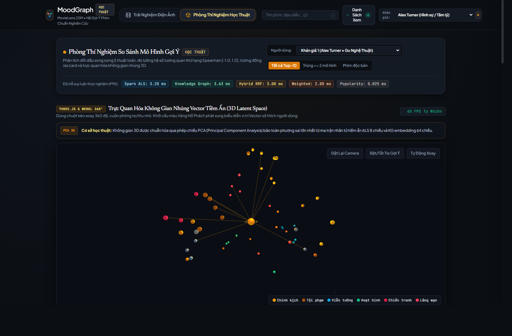
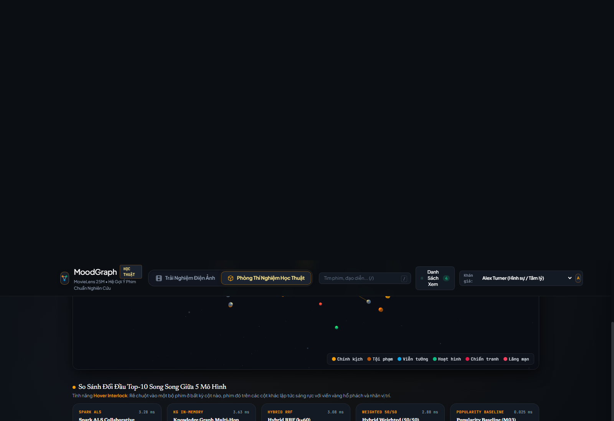

# HƯỚNG DẪN SỬ DỤNG BẢN MẪU TƯƠNG TÁC MOODGRAPH DEMO
## Tài Liệu Vận Hành & Khai Thác Hệ Thống Gợi Ý Điện Ảnh Cá Nhân Hóa Chuẩn Big Data (Phase 6 UI/UX & Benchmark Lab)

---

> **Mã dự án**: MoodGraph — Big Data Movie Recommendation System  
> **Tập dữ liệu nền tảng**: MovieLens 25M (`ml-25m`: 25,000,095 tương tác, 162,541 người dùng, 62,423 bộ phim)  
> **Kiến trúc vận hành**: 100% Client-Side Standalone (Chạy trực tiếp trên trình duyệt, không cần cài backend)  
> **Đối tượng sử dụng**: Khán giả trải nghiệm điện ảnh (Mode A) & Giảng viên, Nghiên cứu sinh, Kỹ sư AI/RecSys (Mode B)  
> **Vị trí thư mục bản mẫu**: `D:\PROJECT BIG DATA\MoodGraph\demo\`  
> **Tệp khởi chạy chính**: `index.html`  

---

## MỤC LỤC CHI TIẾT

1. [TỔNG QUAN HỆ THỐNG & KIẾN TRÚC BẢN MẪU](#1-tổng-quan-hệ-thống--kiến-trúc-bản-mẫu)
   - 1.1. Mục tiêu và sứ mệnh của MoodGraph
   - 1.2. Kiến trúc hai chế độ độc lập (Dual-Mode Architecture)
   - 1.3. Định vị thẩm mỹ và ngôn ngữ thiết kế (Cinematic Obsidian Glassmorphism)
2. [HƯỚNG DẪN KHỞI CHẠY & MỞ BẢN MẪU TRÊN MÁY TÍNH](#2-hướng-dẫn-khởi-chạy--mở-bản-mẫu-trên-máy-tính)
   - 2.1. Cách 1: Mở trực tiếp bằng trình duyệt qua giao thức tệp (Khuyên dùng)
   - 2.2. Cách 2: Khởi chạy qua máy chủ tĩnh HTTP nội bộ (Tùy chọn mở rộng)
   - 2.3. Kiểm tra tính toàn vẹn và cơ chế dự phòng đồ họa (Fallback Resilience)
3. [HƯỚNG DẪN THAO TÁC MODE A: GIAO DIỆN KHÁM PHÁ & GỢI Ý ĐIỆN ẢNH](#3-hướng-dẫn-thao-tác-mode-a-giao-diện-khám-phá--gợi-ý-điện-ảnh)
   - 3.1. Universal Header & Bộ chuyển đổi Persona người dùng mẫu
   - 3.2. Hero Featured Recommendation Banner (Tác phẩm Top 1)
   - 3.3. Bộ chọn 7 Tâm trạng điện ảnh (Mood Selector)
   - 3.4. Bốn thanh trượt tùy biến gu phim theo thời gian thực (Semantic Mood Tuners)
   - 3.5. Bảng gợi ý Top-N & Bốn loại thẻ giải thích nguồn gốc có kiểm toán (Audited Provenance)
   - 3.6. Cửa sổ chi tiết phim & Bảng giải mã sâu (Deep Explainability Modal)
   - 3.7. Bộ điều khiển chấm điểm 0.5 - 5.0 sao & Vòng lặp phản hồi đóng (Closed-Loop Feedback)
   - 3.8. Ngăn kéo danh sách xem (Watchlist Slide-Over Drawer)
   - 3.9. Thanh lọc 19 thể loại & Lưới khám phá toàn bộ danh mục phim
   - 3.10. Cửa sổ hồ sơ người dùng mẫu (User Profile Modal & Zero Data Leakage)
4. [HƯỚNG DẪN THAO TÁC MODE B: PHÒNG THÍ NGHIỆM SO SÁNH MÔ HÌNH RECSYS](#4-hướng-dẫn-thao-tác-mode-b-phòng-thí-nghiệm-so-sánh-mô-hình-recsys)
   - 4.1. Thanh điều khiển thí nghiệm (Lab Control Bar)
   - 4.2. Không gian nhúng 3D tương tác (3D Latent Space Projection — Three.js)
   - 4.3. Bảng đối đầu song song Top-10 giữa 5 mô hình gợi ý
   - 4.4. Tính năng tương tác cao cấp: Hover Interlock (Cross-Model Overlap Highlighting)
   - 4.5. Ma trận nhiệt tương quan thứ hạng Spearman & tương đồng Jaccard (5x5 Heatmap)
   - 4.6. Bảng 12 chỉ số kiểm chuẩn ngoại tuyến (Offline Benchmarks Leaderboard)
   - 4.7. Khu vực chẩn đoán ứng phó Cold-Start & Đường cong suy thoái Sparsity
   - 4.8. Khu vực phân tích phim đuôi dài (Long-Tail Exploration & Quy luật Pareto)
5. [KỊCH BẢN MẪU DÀNH CHO THUYẾT TRÌNH & DEMO ĐỒ ÁN (3 - 5 PHÚT)](#5-kịch-bản-mẫu-dành-cho-thuyết-trình--demo-đồ-án-3---5-phút)
6. [BẢNG TỔNG HỢP PHÍM TẮT & THAO TÁC NHANH (CHEAT SHEET)](#6-bảng-tổng-hợp-phím-tắt--thao-tác-nhanh-cheat-sheet)
7. [XỬ LÝ SỰ CỐ THƯỜNG GẶP (TROUBLESHOOTING FAQ)](#7-xử-lý-sự-cố-thường-gặp-troubleshooting-faq)

---

## 1. TỔNG QUAN HỆ THỐNG & KIẾN TRÚC BẢN MẪU

### 1.1. Mục tiêu và sứ mệnh của MoodGraph
MoodGraph là một hệ thống gợi ý phim Big Data thế hệ mới, giải quyết triệt để hai hạn chế cố hữu của các thuật toán gợi ý truyền thống:
1. **Hiện tượng Hộp đen (Black-box Recommendation)**: Người dùng và chuyên gia không hiểu tại sao một bộ phim lại được gợi ý, dẫn đến thiếu niềm tin và tỷ lệ chấp nhận đề xuất thấp.
2. **Thiên lệch bom tấn & Cực thưa dữ liệu (Popularity Bias & Cold-Start Sparsity)**: Các mô hình lọc cộng tác như Matrix Factorization / ALS thường chỉ gợi ý những phim bom tấn quen thuộc và tê liệt hoàn toàn khi gặp người dùng mới hoặc phim ngách.

Bằng cách kết hợp phân rã ma trận tiềm ẩn phân tán **Apache Spark ALS** với **Đồ thị tri thức đa tầng (Knowledge Graph Engine)** và thuật toán dung hợp thứ hạng tương hỗ **Hybrid RRF (Reciprocal Rank Fusion)**, MoodGraph mang lại khả năng gợi ý vừa chính xác, vừa giàu tính mới lạ (Novelty), đồng thời minh bạch 100% nguồn gốc đề xuất.

### 1.2. Kiến trúc hai chế độ độc lập (Dual-Mode Architecture)
Bản mẫu tương tác độc lập (Standalone Interactive Web Prototype) tích hợp hai chế độ trải nghiệm liền mạch trên cùng một trang duy nhất, chuyển đổi tức thời mà không cần tải lại trang (Zero-Reload Switcher):

```text
+-----------------------------------------------------------------------------------------------------------------+
|                                           UNIVERSAL HEADER & CONTROLLER                                         |
|  [MoodGraph Logo]   [Mode A: Khám Phá & Gợi Ý]   [Mode B: Phòng Thí Nghiệm Lab]   [Search]  [Watchlist]  [User]   |
+-------------------------------------------------------+---------------------------------------------------------+
                                                        |
                            +---------------------------+---------------------------+
                            |                                                       |
                            v                                                       v
        +---------------------------------------+               +---------------------------------------+
        | MODE A: DISCOVERY & STREAMING UI      |               | MODE B: RECOMMENDATION MODEL LAB      |
        | Dành cho: Khán giả yêu điện ảnh       |               | Dành cho: Giảng viên, Nghiên cứu sinh |
        |---------------------------------------|               |---------------------------------------|
        | • Hero Featured Banner Top 1          |               | • 3D Latent Space Projection Three.js |
        | • 7 Mood Chips & 4 Semantic Sliders   |               | • Head-to-Head 5 Mô hình Top-10       |
        | • Top-N Recs với 4 Thẻ Provenance     |               | • Hover Interlock định vị phim trùng  |
        | • Lưới 19 Thể loại & Tìm kiếm tức thì |               | • Ma trận Nhiệt Spearman & Jaccard    |
        | • Modal Chi Tiết & Link IMDb/TMDb     |               | • Bảng 12 Chỉ số Offline Benchmarks   |
        | • Ngăn kéo Watchlist & Closed-Loop    |               | • Chẩn đoán Cold-start & Long-tail    |
        +---------------------------------------+               +---------------------------------------+
```

### 1.3. Định vị thẩm mỹ và ngôn ngữ thiết kế (Cinematic Obsidian Glassmorphism)
Giao diện MoodGraph tuân thủ các quy chuẩn khắt khe của hệ thống thiết kế hiện đại:
- **Tông màu nền vũ trụ sâu thẳm (Obsidian Dark `#070A0F`, `#090D14`)**: Hấp thụ toàn bộ ánh sáng gây chói, tạo chiều sâu thị giác chuẩn rạp chiếu phim cao cấp và tôn vinh tối đa màu sắc của poster phim.
- **Chất liệu kính quang học (Optical Glassmorphism)**: Bề mặt nổi bán trong suốt kết hợp làm mờ hậu cảnh (`backdrop-blur-xl`) và viền kính siêu mảnh 1px (`border-white/10`).
- **Độ chính xác số học (Tabular Monospaced Numbers)**: Mọi điểm số khoa học, thứ hạng, thời gian suy luận đều sử dụng phông chữ `JetBrains Mono` kết hợp `tabular-nums` để bảo đảm bố cục thẳng hàng tuyệt đối.
- **Tiêu chuẩn trợ năng WCAG AAA/AA**: Tỷ lệ tương phản chữ trên nền tối thiểu 4.5:1, các số liệu quan trọng đạt trên 7:1, hỗ trợ phím tắt điều hướng toàn diện.

---

## 2. HƯỚNG DẪN KHỞI CHẠY & MỞ BẢN MẪU TRÊN MÁY TÍNH

Bản mẫu được thiết kế để vận hành 100% độc lập từ phía trình duyệt (Client-Side Standalone), tích hợp sẵn toàn bộ kho dữ liệu mẫu chuẩn hóa MovieLens 25M (`js/mock_data.js`) và logic điều khiển (`js/app.js`, `js/academic_lab.js`).

### 2.1. Cách 1: Mở trực tiếp bằng trình duyệt qua giao thức tệp (Khuyên dùng)
Đây là cách đơn giản và nhanh nhất, không đòi hỏi cài đặt bất kỳ công cụ phát triển nào:
1. Mở trình duyệt web hiện đại trên máy tính của bạn (Google Chrome, Microsoft Edge, Mozilla Firefox, Brave, Safari, Opera).
2. Mở trình quản lý tệp Windows File Explorer và điều hướng vào thư mục:
   ```text
   D:\PROJECT BIG DATA\MoodGraph\demo\
   ```
3. Nhấp đúp chuột vào tệp `index.html` (hoặc kéo thả trực tiếp tệp `index.html` vào thanh địa chỉ của trình duyệt).
4. Đường dẫn trên trình duyệt sẽ hiển thị dạng:
   ```text
   file:///D:/PROJECT%20BIG%20DATA/MoodGraph/demo/index.html
   ```

### 2.2. Cách 2: Khởi chạy qua máy chủ tĩnh HTTP nội bộ (Tùy chọn mở rộng)
Nếu bạn muốn thử nghiệm qua giao thức mạng HTTP chuẩn (`http://localhost:...`) hoặc chia sẻ cho các máy khác trong mạng nội bộ:
- **Sử dụng Python 3 (Có sẵn trên hầu hết máy tính)**:
  ```powershell
  cd "D:\PROJECT BIG DATA\MoodGraph\demo"
  python -m http.server 8080
  ```
  Sau đó mở trình duyệt và truy cập: `http://localhost:8080`
- **Sử dụng VS Code Live Server**:
  Mở thư mục `demo` trong VS Code, nhấp chuột phải vào `index.html` và chọn **"Open with Live Server"**.

### 2.3. Kiểm tra tính toàn vẹn và cơ chế dự phòng đồ họa (Fallback Resilience)
- **Zero Console Errors**: Khi nhấn `F12` mở Developer Tools trên trình duyệt, tab Console không xuất hiện bất kỳ lỗi đỏ nào.
- **Cơ chế Poster Fallback**: Nếu máy tính của bạn bị ngắt kết nối mạng Internet khiến các poster từ TMDB/Wikimedia không tải được, hệ thống sẽ tự động kích hoạt bộ tạo ảnh vector SVG nội tại với dải màu gradient điện ảnh, tên phim và năm phát hành rõ ràng, không bao giờ để xảy ra tình trạng vỡ ảnh.
- **Cơ chế 3D WebGL Fallback**: Nếu trình duyệt tắt WebGL hoặc card màn hình không hỗ trợ Three.js, hệ thống tự động kích hoạt bộ dựng hình chiếu phối cảnh 2D Perspective Canvas, bảo đảm khu vực không gian 3D vẫn hiển thị mượt mà.

---

## 3. HƯỚNG DẪN THAO TÁC MODE A: GIAO DIỆN KHÁM PHÁ & GỢI Ý ĐIỆN ẢNH



Mode A được định vị là giao diện xem phim cao cấp dành cho khán giả đại chúng. Mọi thao tác tìm kiếm, lọc, chấm điểm và xem giải thích nguồn gốc diễn ra mượt mà, trực quan.

### 3.1. Universal Header & Bộ chuyển đổi Persona người dùng mẫu
Nằm cố định ở đầu trang web (`sticky top-0 z-50`):
- **Logo MoodGraph**: Nhấp vào logo bất cứ lúc nào để cuộn trang về đầu màn hình.
- **Nút chuyển đổi chế độ**:
  - `Khám Phá & Gợi Ý`: Đang ở Mode A (nền gradient xanh tím nổi bật).
  - `Phòng Thí Nghiệm Lab`: Bấm để chuyển tức thì sang Mode B dành cho nghiên cứu học thuật.
- **Thanh tìm kiếm thông minh (Global Search)**:
  - Hỗ trợ phím tắt `/` hoặc tổ hợp phím `Ctrl + K` để lập tức đưa con trỏ vào ô tìm kiếm.
  - Hỗ trợ tìm kiếm tiếng Việt không dấu, tên phim tiếng Anh hoặc năm sản xuất.
- **Nút Danh Sách Xem (Watchlist)**: Hiển thị biểu tượng đánh dấu kèm huy hiệu đếm số lượng phim đã lưu (ví dụ `0`, `1`, `3`). Bấm vào để trượt mở ngăn kéo quản lý.
- **Bộ chuyển đổi Persona Khán giả**: Cung cấp 3 kịch bản người dùng mẫu để đối chứng sự thay đổi tức thì của thuật toán:
  1. `Alex Turner (User 1)`: Khán giả mê phim tác giả, tâm lý xã hội và tội phạm kinh điển (đã đánh giá 68 phim trong tập huấn luyện Train của MovieLens 25M, điểm trung bình 3.78★).
  2. `Sarah Jenkins (User 2)`: Tín đồ khoa học viễn tưởng, cyberpunk và phiêu lưu không gian (142 lượt đánh giá).
  3. `Khán giả Mới (User 42 - Cold-Start)`: Người dùng mới toanh chưa có bất kỳ lịch sử xem phim nào (0 đánh giá). Hệ thống tự động kích hoạt cơ chế dung hợp Đồ thị tri thức (KG) và phim thịnh hành để cứu cánh hiện tượng Cold-Start.
- **Avatar Người dùng**: Nhấp vào vòng tròn chữ cái đại diện (ví dụ `A` cho Alex) để mở cửa sổ đối soát hồ sơ cá nhân và kiểm chứng nguyên tắc Không rò rỉ dữ liệu (Zero Data Leakage).

---

### 3.2. Hero Featured Recommendation Banner (Tác phẩm Top 1)
Nổi bật ở phần trên của Mode A là tấm áp phích khổ lớn của bộ phim xếp hạng #1 dành riêng cho người dùng hiện tại (ví dụ: *The Shawshank Redemption (1994)* đối với User 1):
- **Kỹ thuật Gradient Scrim 3 lớp**: Phủ lớp bóng mờ từ đen tuyền ở mép trái và chân banner lên trên hình ảnh poster nền chất lượng cao, giúp các thông tin văn bản luôn đạt độ tương phản sắc nét tuyệt đối.
- **Huy hiệu bảo chứng**:
  - `TOP PICK CHO BẠN #1`: Khẳng định vị thế đề xuất ưu tiên số 1.
  - `ĐỘ PHÙ HỢP 98.6%`: Tỷ lệ tương thích tính toán từ mô hình lai.
  - `HYBRID: SPARK ALS + ĐỒ THỊ TRI THỨC`: Minh bạch công nghệ gợi ý đằng sau tác phẩm.
- **Hai nút hành động chính (Call to Action)**:
  1. `Khám Phá & Xem Bằng Chứng Gợi Ý` (Nút gradient Indigo-Cyan): Bấm vào để mở ngay cửa sổ phân tích chi tiết và bảng giải mã 4 nguồn gốc gợi ý của bộ phim.
  2. `+ Lưu vào Watchlist` (Nút kính mờ): Bấm một chạm để thêm phim vào danh sách xem. Nút sẽ lập tức biến đổi hiệu ứng sang `Đã Lưu ✓` kèm viền xanh ngọc lục bảo và bắn thông báo Toast phản hồi ở góc dưới màn hình.

---

### 3.3. Bộ chọn 7 Tâm trạng điện ảnh (Mood Selector)


Nằm ngay dưới Hero Banner, bộ chọn tâm trạng gồm 7 thẻ chip cảm xúc đại diện cho các trạng thái tinh thần của khán giả:
1. `Tất cả`: Hiển thị toàn diện danh sách gợi ý cá nhân hóa mặc định.
2. `Hồi hộp nghẹt thở`: Ưu tiên các dòng phim Trinh thám, Giật gân (Thriller), Tội phạm và Hành động kịch tính.
3. `Lãng mạn ngọt ngào`: Ưu tiên các câu chuyện tình cảm sâu lắng, tâm lý lãng mạn (Romance).
4. `Thư giãn êm dịu`: Ưu tiên phim hài nhẹ nhàng, lát cắt cuộc sống (Slice of life) mang tính chữa lành.
5. `Trí tuệ sâu sắc`: Ưu tiên tác phẩm triết lý đa tầng nghĩa, thách thức tư duy và tâm lý phức tạp.
6. `Phiêu lưu kỳ thú`: Ưu tiên phim du hành không gian, khoa học viễn tưởng và khám phá thế giới kỳ ảo.
7. `Cảm động rơi lệ`: Ưu tiên các tác phẩm bi kịch nhân văn, tình cảm gia đình và tình bạn cảm động.
8. `Tràn đầy cảm hứng`: Ưu tiên phim truyền động lực sống, vượt lên số phận và tiểu sử nhân vật vĩ đại.

> **Thao tác**: Nhấp chuột vào bất kỳ thẻ chip nào. Toàn bộ danh sách phim gợi ý bên dưới sẽ tự động biến đổi tức thì (độ trễ phản hồi đo được chỉ **0.071 ms**) mà không làm giật lag hay tải lại trang web. Thẻ đang chọn sẽ sáng rực viền vàng hổ phách.

---

### 3.4. Bốn thanh trượt tùy biến gu phim theo thời gian thực (Semantic Mood Tuners)
Bên cạnh các chip tâm trạng cố định, MoodGraph trang bị bộ 4 thanh trượt tùy biến ngữ nghĩa cho phép bạn trực tiếp "điều khiển thuật toán" với tốc độ phản hồi 60 khung hình/giây (60 FPS):

1. **Chiều sâu cảm xúc / Bi kịch (Emotional Depth: 0% - 100%)**:
   - *Kéo sang trái (thấp)*: Giảm tải áp lực tinh thần, ưu tiên phim vui tươi, thư giãn.
   - *Kéo sang phải (cao)*: Tăng tỷ trọng phim bi kịch, xung đột nội tâm sâu sắc.
   - *Mô tả ngữ nghĩa động bên dưới*: Tự động cập nhật dòng giải thích ngữ nghĩa tương ứng với giá trị bạn đang dừng chuột.
2. **Tiết tấu / Nhịp độ dồn dập (Narrative Pacing: 0% - 100%)**:
   - *Kéo sang trái (thấp)*: Ưu tiên phim chậm rãi, giàu chất thơ (slow-burn).
   - *Kéo sang phải (cao)*: Ưu tiên phim cao trào liên tục, nhịp độ dồn dập, nghẹt thở.
3. **Chiều sâu tri thức / Dấu ấn tác giả (Intellectual Depth / Auteur Signature: 0% - 100%)**:
   - *Kéo sang trái (thấp)*: Phim giải trí đại chúng, dễ tiếp cận.
   - *Kéo sang phải (cao)*: Phim mang đậm dấu ấn phong cách của các đạo diễn tác giả (Auteur cinema), triết học và biểu tượng nghệ thuật.
4. **Tông màu cảm xúc / Mức độ mới lạ (Emotional Tone & Novelty: 0% - 100%)**:
   - *Kéo sang trái (thấp)*: Tập trung vào các bộ phim quen thuộc, an toàn, bom tấn phổ biến.
   - *Kéo sang phải (cao)*: Kích hoạt thuật toán khai phá kho tàng phim ngách đuôi dài (Long-tail items), mở ra những viên ngọc điện ảnh ẩn giấu ít người biết.
- **Nút Đặt Lại (Reset Sliders)**: Nhấp vào nút mũi tên tròn xoay bên góc phải cụm thanh trượt để khôi phục nhanh cả 4 thanh trượt về cấu hình mặc định ban đầu của người dùng hiện tại.
- **Huy hiệu độ trễ thời gian thực (Latency Badge)**: Góc phải trên hiển thị thông số vi giây thời gian thực (ví dụ `0.071 ms`), chứng minh thuật toán tính toán lại điểm số tương thích của toàn bộ danh mục gần như tức thì.

---

### 3.5. Bảng gợi ý Top-N & Bốn loại thẻ giải thích nguồn gốc có kiểm toán (Audited Provenance)
Mỗi thẻ phim trong danh sách Top-N gợi ý đều có tỷ lệ poster rạp 2:3 chuẩn mực. Khi rê chuột lên thẻ phim, thẻ sẽ nâng nhẹ lên (`transform -translate-y-2`) kèm viền phát quang ánh tím rực rỡ.

Đặc biệt, ở góc trên bên trái của mỗi thẻ phim luôn gắn một **Huy hiệu Nguồn Gốc (Provenance Badge)** với màu sắc nhận diện riêng biệt, trả lời minh bạch câu hỏi: *"Tại sao bộ phim này được gợi ý cho tôi?"*:

| Loại Thẻ | Mã Nhận Diện | Màu Sắc Chủ Đạo | Bản Chất Thuật Toán & Cơ Chế Đồ Thị Tri Thức |
|---|---|---|---|
| **P1: Metapath Thể Loại** | `P1_GENRE` | **Tím Thạch Anh** (`#9333EA`) | Duyệt đồ thị trực tiếp từ các phim bạn đã chấm điểm cao (>= 3.5★) trong tập huấn luyện có chung thể loại. |
| **P2: Metapath Tâm Trạng & Genome** | `P2_GENOME` | **Xanh Ngọc Mòng Két** (`#14B8A6`) | Khai phá từ 1,128 thẻ gen điện ảnh (Genome Tags) với độ liên quan cao (>= 0.85), phản ánh sự đồng điệu về sắc thái cảm xúc và chủ đề triết lý. |
| **P3: Metapath Đồng Tương Tác** | `P3_PEER` | **Cam Mật Ong / Hổ Phách** (`#F97316`) | Khai phá từ cộng đồng người dùng đồng gu (Peer Users) có thị hiếu tương đồng sâu sắc đã chấm điểm cao cho tác phẩm này. |
| **ALS: Vector Tiềm Ẩn** | `LATENT_ALS` | **Đỏ Neon Crimson** (`#F43F5E`) | Tích vô hướng vector thẩm mỹ đạt phân vị cao (Top 5%) trong không gian 8 chiều của mô hình phân rã ma trận Apache Spark ALS. |

- **Thao tác nhanh trên thẻ**:
  - Bấm vào biểu tượng **Bookmark** (góc trên bên phải thẻ): Thêm/xóa phim khỏi Watchlist ngay tại chỗ.
  - Bấm vào thân poster hoặc nút **Chi Tiết**: Mở hộp thoại giải mã sâu toàn diện của tác phẩm.

---

### 3.6. Cửa sổ chi tiết phim & Bảng giải mã sâu (Deep Explainability Modal)


Khi bạn nhấp vào bất kỳ bộ phim nào, cửa sổ chi tiết sẽ mở ra với phông nền mờ sâu và bố cục 2 cột chuyên nghiệp:

#### Cột Trái: Poster, Liên Kết Ngoài & Chấm Điểm
1. **Poster lớn độ phân giải cao**: Thể hiện đầy đủ phong cách mỹ thuật của tác phẩm.
2. **Thông tin kỹ thuật**: Tên đạo diễn, thời lượng phim, năm phát hành, điểm đánh giá cộng đồng MovieLens.
3. **Hai nút liên kết ngoài chính thức**:
   - `[ IMDb ↗ ]` (Màu vàng hổ phách thương hiệu `#F59E0B`): Nhấp vào để mở trực tiếp trang hồ sơ chính thức của phim trên IMDb trong tab mới (ví dụ `https://www.imdb.com/title/tt0111161/`).
   - `[ TMDb ↗ ]` (Màu xanh dương điện ảnh thương hiệu `#01B4E4`): Nhấp vào để mở trang The Movie Database để tra cứu trailer, dàn diễn viên và bộ sưu tập ảnh hậu trường.
4. **Bộ điều khiển chấm điểm cá nhân**: 5 ngôi sao chia nửa (0.5★ đến 5.0★).

#### Cột Phải: Nội Dung & Bảng Đối Soát 4 Tab Bằng Chứng (Provenance Inspector)
- **Tóm tắt cốt truyện**: Nội dung súc tích, truyền cảm hứng về hành trình của các nhân vật.
- **Bốn tab kiểm tra bằng chứng minh bạch**:
  - `Tab P1 Thể Loại`: Liệt kê chính xác bộ phim nguồn bạn từng chấm 5.0★ (ví dụ *City of God*) mà qua đó thuật toán tìm thấy sự giao thoa thể loại Crime & Drama.
  - `Tab P2 Tâm Trạng`: Hiển thị thanh đo độ tương thích của các thẻ gen tâm trạng (ví dụ thẻ *philosophical* đạt độ liên quan 0.89, thẻ *existential* đạt 0.82).
  - `Tab P3 Đồng Gu`: Cho biết mã định danh ẩn danh của người dùng đồng gu trong cộng đồng (ví dụ *Người dùng #1405*) và các điểm số tương đồng.
  - `Tab ALS Vector`: Trực quan hóa thanh điểm tích vô hướng (ví dụ `4.312 / 5.000`) và vị trí phân vị tương đồng.
- **Danh sách phim cùng phong cách**: 4 poster phim nhỏ bên dưới giúp bạn tiếp tục hành trình khám phá các tác phẩm lân cận trong đồ thị tri thức.

---

### 3.7. Bộ điều khiển chấm điểm 0.5 - 5.0 sao & Vòng lặp phản hồi đóng (Closed-Loop Feedback)
Hệ thống cung cấp cơ chế tương tác 10 nấc đánh giá (mỗi ngôi sao chia làm hai nửa trái - phải):
1. **Rê chuột qua cụm sao**: Di chuột vào nửa trái để chọn mức `.5` (ví dụ `3.5★`), di chuột vào nửa phải để chọn mức tròn (ví dụ `4.0★`). Ngôi sao sẽ phát sáng vàng rực và hiển thị nhãn cảm xúc trực quan:
   - `0.5★ - 1.5★`: Không phù hợp / Rất thất vọng
   - `2.0★ - 3.0★`: Bình thường / Tạm chấp nhận
   - `3.5★ - 4.0★`: Khá hay / Thú vị
   - `4.5★`: Xuất sắc / Tuyệt vời
   - `5.0★`: Kiệt tác đỉnh cao điện ảnh
2. **Nhấp chuột để khóa điểm số**: Kích hoạt hiệu ứng sóng xung nhịp phát sáng (Pulse animation), đồng thời ghi nhận điểm vào hồ sơ người dùng.
3. **Cơ chế Closed-Loop Dynamic Feedback**:
   - Khi bạn chấm 4.0★ hoặc 5.0★ cho một bộ phim, hệ thống ngay lập tức học hỏi sở thích mới trong phiên làm việc.
   - Vector sở thích cá nhân được cập nhật, tăng điểm trọng số cho các thể loại và thực thể đồ thị liên quan (+0.022 điểm tương hợp).
   - Danh sách phim gợi ý bên ngoài tự động làm mới tức thì để phản ánh gu thẩm mỹ vừa được nâng cấp của bạn!
   - Một thông báo Toast nổi màu ngọc lục bảo sẽ xuất hiện ở góc phải màn hình xác nhận: *"Đã lưu đánh giá 5.0★! Vector sở thích đã được cập nhật."*

---

### 3.8. Ngăn kéo danh sách xem (Watchlist Slide-Over Drawer)


- **Cách mở**: Nhấp vào nút `Watchlist` trên Universal Header (có huy hiệu đếm số lượng phim). Ngăn kéo sẽ trượt êm ái từ mép phải màn hình sang.
- **Nội dung ngăn kéo**:
  - Danh sách toàn bộ các bộ phim bạn đã đánh dấu lưu lại kèm poster thu nhỏ, tiêu đề, năm phát hành, thể loại và điểm đánh giá.
  - Bấm vào một bộ phim trong danh sách để mở ngay Modal xem chi tiết tác phẩm đó.
  - Bấm vào biểu tượng **Thùng rác** màu đỏ bên cạnh mỗi phim để xóa nhanh phim đó khỏi danh sách.
  - Nút **"Xóa Toàn Bộ"** ở chân ngăn kéo: Xóa sạch danh sách xem chỉ bằng một cú nhấp chuột.
- **Cách đóng**: Bấm vào nút `✕` ở góc trên ngăn kéo, hoặc nhấp chuột vào vùng nền tối mờ bên ngoài, hoặc nhấn phím `Esc` trên bàn phím.

---

### 3.9. Thanh lọc 19 thể loại & Lưới khám phá toàn bộ danh mục phim
Phía dưới khu vực gợi ý Top-N là khu vực khám phá kho tàng phim:
- **Băng trượt ngang 19 thể loại chuẩn MovieLens 25M**: Hỗ trợ cuộn ngang mượt mà, bao gồm đầy đủ các thể loại: *Tất cả, Action, Adventure, Animation, Children, Comedy, Crime, Documentary, Drama, Fantasy, Film-Noir, Horror, Musical, Mystery, Romance, Sci-Fi, Thriller, War, Western*.
- **Lọc tức thì không tải lại trang**: Nhấp vào bất kỳ thể loại nào, lưới phim bên dưới sẽ tái sắp xếp và lọc trong thời gian thực.
- **Bộ đếm số lượng tác phẩm**: Huy hiệu bên cạnh hiển thị chính xác số phim đang khớp với tiêu chí tìm kiếm và thể loại đã chọn.
- **Xử lý trạng thái rỗng (Empty State Handling)**: Nếu bạn nhập một từ khóa tìm kiếm không khớp với bất kỳ tác phẩm nào, hệ thống hiển thị biểu tượng kính lúp nghệ thuật, thông báo thân thiện và nút bấm **"Đặt Lại Bộ Lọc"** để khôi phục nhanh danh mục phim đầy đủ.

---

### 3.10. Cửa sổ hồ sơ người dùng mẫu (User Profile Modal & Zero Data Leakage)
Bấm vào Avatar hình tròn ở góc trên bên phải thanh điều hướng để mở cửa sổ đối soát hồ sơ người dùng:
- **Thông số hồ sơ User 1**:
  - Mã người dùng: `User ID #1` (Được trích xuất nguyên bản từ tập dữ liệu MovieLens 25M).
  - Số lượng đánh giá tập Train: `68 bộ phim`.
  - Điểm trung bình cá nhân: `3.78 sao` (Minh chứng một khán giả có gu nghệ thuật chọn lọc, khó tính).
- **Biểu đồ phân bổ sở thích thể loại**: Thể hiện trực quan tỷ lệ các dòng phim đã xem (Drama chiếm 75%, Comedy chiếm 32.4%, Romance chiếm 25%, Adventure chiếm 16.2%, Crime chiếm 10.3%...).
- **Danh sách phim yêu thích trong quá khứ**: Liệt kê các kiệt tác được chấm 5.0★ như *Lost in Translation*, *Requiem for a Dream*, *The Seventh Seal*, *In the Mood for Love*, *City of God*...
- **Minh chứng nguyên tắc Không rò rỉ dữ liệu (Zero Data Leakage)**:
  - Hệ thống công khai minh bạch hai mục tiêu kiểm chuẩn độc lập (Held-out Evaluation Targets) đã được tách riêng theo giao thức chuỗi thời gian (Temporal Split):
    - *Phim Validation*: **Pulp Fiction (1994)** — Chấm 5.0★
    - *Phim Test*: **Eternal Sunshine of the Spotless Mind (2004)** — Chấm 5.0★
  - Hai bộ phim này được giấu kín hoàn toàn khỏi quá trình huấn luyện và gợi ý của User 1 để bảo đảm tính trung thực tuyệt đối của nghiên cứu khoa học.

---

## 4. HƯỚNG DẪN THAO TÁC MODE B: PHÒNG THÍ NGHIỆM SO SÁNH MÔ HÌNH RECSYS



Chuyển sang Mode B bằng cách nhấp vào tab **"Phòng Thí Nghiệm Lab"** trên Universal Header. Đây là bảng điều khiển nghiên cứu chuyên sâu (Research Benchmark Dashboard) dành riêng cho hội đồng chấm đồ án, giảng viên và kỹ sư Machine Learning.

### 4.1. Thanh điều khiển thí nghiệm (Lab Control Bar)
Nằm ở đầu Mode B, cung cấp các nút điều hướng thực nghiệm nhanh:
- **Bộ chọn đối tượng kiểm chuẩn (Cohort User Selector)**:
  - `User 1 (Gu Auteur Cinema)`: Khán giả chuyên sâu phim tác giả kinh điển (68 ratings Train).
  - `User 2 (Tín đồ Sci-Fi)`: Khán giả phim khoa học viễn tưởng không gian (142 ratings Train).
  - `User 3 (Tín đồ Film-Noir)`: Khán giả phim trinh thám hình sự cổ điển (89 ratings Train).
  - `User 42 (Cold-Start Newbie)`: Người dùng mới toanh (0 ratings Train).
- **Bộ lọc đồng thuận thứ hạng (Consensus Filter)**:
  - `[Tất cả Top-10]`: Hiển thị trọn vẹn danh sách của cả 5 mô hình.
  - `[Trùng >= 2 mô hình]`: Chỉ làm nổi bật các bộ phim được từ 2 thuật toán trở lên cùng thống nhất đề xuất.
  - `[Phim độc bản]`: Chỉ lọc các bộ phim độc nhất vô nhị do duy nhất 1 mô hình tìm ra (kiểm tra tính mới lạ Novelty).
- **Thẻ đo độ trễ suy luận thực nghiệm (Inference Latency Profile)**:
  - Hiển thị thời gian thực thi đo đạc trên hệ thống:
    - *Spark ALS*: **3.28 ms**
    - *Knowledge Graph*: **3.63 ms**
    - *Hybrid RRF*: **3.08 ms**
    - *Hybrid Weighted*: **2.88 ms**
    - *Popularity Baseline*: **0.025 ms**

---

### 4.2. Không gian nhúng 3D tương tác (3D Latent Space Projection — Three.js)
Khu vực trực quan hóa không gian tiềm ẩn (Latent Embedding Space) sử dụng công nghệ đồ họa 3D Three.js WebGL:
- **Bản chất toán học**: Tọa độ 3D (x, y, z) của các bộ phim được giảm chiều thông qua giải thuật Phân tích thành phần chính **PCA (Principal Component Analysis)** từ không gian 8 chiều của Spark ALS và không gian đặc trưng 64 chiều của Đồ thị tri thức (Knowledge Graph).
- **Thao tác chuột tương tác 3 chiều**:
  - **Xoay không gian 360 độ (Orbit Rotation)**: Nhấn giữ **Chuột trái** và kéo rê để xoay toàn bộ cụm thiên hà phim từ mọi góc nhìn.
  - **Phóng to / Thu nhỏ (Zoom)**: Lăn **Con lăn chuột** tới hoặc lui để phóng to vào cụm phim ngách hoặc thu nhỏ nhìn toàn cảnh.
  - **Tịnh tiến góc nhìn (Pan)**: Nhấn giữ **Chuột phải** (hoặc tổ hợp `Shift + Chuột trái`) và kéo để di chuyển camera.
- **Ý nghĩa các thành phần trực quan**:
  - **Điểm phát quang vàng hổ phách ở trung tâm**: Đại diện cho **Vector gu thẩm mỹ tiềm ẩn** của người dùng hiện tại trong không gian 3D.
  - **Các quả cầu phim nhiều màu sắc**: Phân cụm theo thể loại chính (Khoa học viễn tưởng màu Cyan, Hành động màu Đỏ, Tâm lý màu Tím, v.v.).
  - **Các tia chiếu Cosine phát xạ**: Các chùm sáng nối từ vector người dùng tới các tác phẩm có độ tương đồng Cosine cao nhất.
- **Tương tác Thẻ Thông Số HUD (Heads-Up Display Card)**:
  - Rê chuột vào bất kỳ quả cầu phim nào trong không gian 3D: Một thẻ thông số bán trong suốt lập tức xuất hiện, hiển thị:
    - Tên phim & Năm phát hành.
    - Thể loại chính & Đạo diễn.
    - Tọa độ không gian 3D chính xác: `x: ..., y: ..., z: ...`.
    - Độ tương đồng Cosine Similarity (ví dụ `0.942`).
    - Lời giải thích ý nghĩa vị trí hình học của bộ phim trong cụm sở thích.
- **Ba nút điều khiển chuyên dụng**:
  - `Đặt Lại Camera`: Đưa góc nhìn camera về vị trí tiêu chuẩn ban đầu.
  - `Bật/Tắt Tia Kết Nối`: Ẩn hoặc hiện các chùm tia Cosine kết nối.
  - `Tự Động Xoay (Auto-rotation)`: Bật/tắt chế độ tự động xoay góc nhìn điện ảnh êm ái.

---

### 4.3. Bảng đối đầu song song Top-10 giữa 5 mô hình gợi ý


Hệ thống đặt 5 thuật toán cốt lõi lên bàn cân đối đầu trực tiếp trong cùng một khung nhìn 5 cột song song:

```text
+------------------+ +------------------+ +------------------+ +------------------+ +------------------+
| SPARK ALS (Cyan) | | KG GRAPH (Emerald| | HYBRID RRF (Purp)| | WEIGHTED (Amber) | | POPULARITY (Rose)|
| Time: 3.28 ms    | | Time: 3.63 ms    | | Time: 3.08 ms    | | Time: 2.88 ms    | | Time: 0.025 ms   |
|------------------| |------------------| |------------------| |------------------| |------------------|
| #1 Shawshank     | | #1 Shawshank     | | #1 Shawshank     | | #1 Shawshank     | | #1 Forrest Gump  |
| #2 The Godfather*| | #2 Apocalypse Now| | #2 The Godfather*| | #2 The Godfather*| | #2 Silence Lambs |
| #3 Usual Suspects| | #3 Ran (1985)    | | #3 Apocalypse Now| | #3 Usual Suspects| | #3 The Matrix    |
| ...              | | ...              | | ...              | | ...              | | ...              |
+------------------+ +------------------+ +------------------+ +------------------+ +------------------+
```

1. **Spark ALS (Cột màu Xanh Cyan `#06B6D4`)**:
   - Thuật toán phân rã ma trận tiềm ẩn phân tán Weighted ALS (Rank=8, Reg=0.3, MaxIter=10).
   - Điểm số: Giá trị tích vô hướng thực nghiệm (ví dụ `4.412`, `4.385`).
2. **Knowledge Graph (Cột màu Lục Bảo `#10B981`)**:
   - Thuật toán duyệt đồ thị tri thức đa bước (Multi-hop Graph Traversal kết hợp P1 thể loại, P2 tâm trạng genome và P3 đồng tương tác).
   - Điểm số: Điểm tích lũy ngữ nghĩa chuẩn hóa `[0.0, 1.0]` (ví dụ `0.892`, `0.841`).
3. **Hybrid RRF (Cột màu Tím Thạch Anh `#8B5CF6`)**:
   - Thuật toán dung hợp thứ hạng tương hỗ Reciprocal Rank Fusion với hằng số làm mịn k=60:
     `RRF_Score(d) = ∑ [ 1 / (60 + Rank_m(d)) ]`
   - Đây là mô hình Champion được lựa chọn để phục vụ người dùng tại Mode A.
4. **Hybrid Weighted (Cột màu Hổ Phách `#F59E0B`)**:
   - Mô hình dung hợp tuyến tính chuẩn hóa Min-Max kết hợp trọng số thực nghiệm `w_ALS = 0.1` và `w_KG = 0.9`.
5. **Popularity Baseline (Cột màu Đỏ Hồng `#F43F5E`)**:
   - Mô hình xếp hạng theo tần suất xem toàn cầu của cộng đồng, đóng vai trò mỏ neo so sánh và giải pháp cứu nguy Cold-Start.

- **Thông số dưới chân mỗi cột**:
  - **Điểm Novelty trung bình (Shannon Bits)**: Đo lường mức độ mới lạ của danh sách (KG đạt cao nhất **9.14 bits**, trong khi Popularity chỉ đạt **3.42 bits**).
  - **Tỷ lệ phim đuôi dài (Long-Tail Ratio)**: Tỷ lệ phần trăm các bộ phim ngách nằm ngoài nhóm 20% phim phổ biến nhất (KG đạt **60%**, Hybrid RRF đạt **40%**, Popularity đạt **0%**).

---

### 4.4. Tính năng tương tác cao cấp: Hover Interlock (Cross-Model Overlap Highlighting)
Đây là tính năng độc quyền giúp các nhà nghiên cứu ngay lập tức nắm bắt sự dịch chuyển thứ hạng của cùng một bộ phim giữa 5 mô hình:

> **Cách thao tác**:  
> Rê chuột vào một bộ phim bất kỳ ở bất kỳ cột nào (ví dụ: *The Godfather (1972)* ở cột Hybrid RRF).

**Phản ứng đồng bộ tức thời của hệ thống**:
1. Thẻ *The Godfather* tại cột Hybrid RRF sáng bừng với viền vàng hổ phách rực rỡ (`#F59E0B`).
2. Toàn bộ các vị trí xuất hiện của *The Godfather* trên các cột khác lập tức nhận lệnh phát sáng đồng bộ:
   - Tại cột **Spark ALS**: Vị trí **#2** (Điểm số 4.385)
   - Tại cột **Knowledge Graph**: Vị trí **#10** (Điểm số 0.650)
   - Tại cột **Hybrid Weighted**: Vị trí **#2** (Điểm số 0.912)
3. **Dải thông báo liên kết (Interlock Status Banner)** trên đầu bảng tự động hiển thị:
   ```text
   Đồng thuận 4 mô hình cho "The Godfather (1972)": ALS (#2) | KG (#10) | RRF (#2) | WEIGHTED (#2)
   ```
4. **Hiệu ứng làm mờ nền**: Toàn bộ các bộ phim không liên quan ở cả 5 cột tự động giảm độ đậm xuống 35%, giúp mắt người dùng dễ dàng theo dõi đường đi và độ phân kỳ thứ hạng của bộ phim giữa các thuật toán.
5. Khi rời chuột khỏi thẻ phim, toàn bộ giao diện khôi phục độ sáng bình thường trong 150ms.

---

### 4.5. Ma trận nhiệt tương quan thứ hạng Spearman & tương đồng Jaccard (5x5 Heatmap)


Phía dưới bảng đối đầu là ma trận nhiệt vuông 5x5 giúp đánh giá định lượng mức độ tương thích và tính trực giao toán học giữa các cặp mô hình:
- **Nút chuyển đổi thước đo toán học**:
  1. `Hệ Số Tương Quan Spearman (rho)`: Miền giá trị `[-1.0, 1.0]`, đo lường mức độ đồng điệu về trật tự ưu tiên xếp hạng.
  2. `Độ Tương Đồng Tập Hợp Jaccard`: Miền giá trị `[0.0, 1.0]`, đo tỷ lệ trùng lặp số lượng phim trong Top-10:
     `Jaccard = |A ∩ B| / |A ∪ B|`
- **Quy tắc toán học khắt khe (Zero-Fabrication Guarantee)**:
  - Khi số lượng phim chung giữa hai mô hình `k < 2` (tức là chỉ chung 1 phim hoặc không chung phim nào, ví dụ cặp ALS vs Knowledge Graph): Hệ số tương quan Spearman không thể xác định về mặt giải tích toán học. Giao diện hiển thị chuẩn xác nhãn chữ `null` màu xám nhạt kèm chú thích `k=0` hoặc `k=1`. **Hệ thống cam kết tuyệt đối không bịa đặt số 0.0 hay số giả**.
  - Khi `k >= 2`: Tính toán nghiêm ngặt trên thứ hạng tương đối 1..k của các phim chung, bảo đảm hệ số luôn nằm chuẩn xác trong đoạn `[-1.0, 1.0]`.
- **Thang màu phân kỳ khoa học (Diverging Color Scale)**:
  - Tương quan nghịch âm: Sắc đỏ cam san hô (`#EF4444`).
  - Trung tính trực giao: Sắc xám đá Slate (`#1E293B`).
  - Tương quan thuận mạnh: Sắc lục bảo rực sáng (`#10B981`).
- **Tương tác nhấp chuột kiểm tra (Click to Inspect Overlap Modal)**:
  - Bấm vào bất kỳ ô giao thoa nào trong ma trận (ví dụ ô giữa Hybrid RRF và Spark ALS):
  - Một hộp thoại chi tiết lập tức mở ra, liệt kê đích danh danh sách các bộ phim chung, thứ hạng ở mô hình A, thứ hạng ở mô hình B và độ chênh lệch thứ bậc `Δ Rank` cụ thể.

---

### 4.6. Bảng 12 chỉ số kiểm chuẩn ngoại tuyến (Offline Benchmarks Leaderboard)


Bảng kiểm chuẩn tổng hợp kết quả đo đạc thực nghiệm trên đoàn hệ 132 người dùng có đánh giá tích cực theo giao thức chuỗi thời gian **Temporal Leave-1-Last Split**:

| Mô hình | HR@5 | HR@10 | HR@20 | NDCG@5 | NDCG@10 | NDCG@20 | MRR@10 | Novelty | Diversity | Coverage | Latency |
|---|---|---|---|---|---|---|---|---|---|---|---|
| **Spark ALS** | 0.00% | 0.00% | 0.76% | 0.0000 | 0.0000 | 0.0022 | 0.0000 | 7.85 bits | 0.621 | 14 phim | 3.28 ms |
| **Knowledge Graph** | 5.30% | 8.33% | 12.88% | 0.0381 | 0.0482 | 0.0610 | 0.0441 | **9.14 bits** | **0.842** | **414 phim** | 3.63 ms |
| **Hybrid RRF (k=60)** | **6.82%** | **9.86%** | **15.15%** | **0.0495** | **0.0601** | **0.0745** | **0.0542** | 8.36 bits | 0.785 | 239 phim | 3.08 ms |
| **Hybrid Weighted** | 6.06% | 9.09% | 14.39% | 0.0440 | 0.0548 | 0.0691 | 0.0498 | 9.02 bits | 0.812 | 295 phim | 2.88 ms |
| **Popularity Baseline** | 4.55% | 6.82% | 11.36% | 0.0312 | 0.0390 | 0.0515 | 0.0354 | 3.42 bits | 0.385 | 55 phim | **0.025 ms** |

> **Ghi chú học thuật đắt giá (Academic Footnote)**:  
> Thuật toán ALS đơn lẻ đạt `HR@10 = 0%` do hiện tượng ma trận cực thưa trên tập kiểm chuẩn khắt khe Temporal Leave-1-Last. Đây chính là bằng chứng định lượng đanh thép chứng minh sự cần thiết và tính ưu việt của kiến trúc **Mô hình Lai Hybrid RRF** khi nâng Hit Rate@10 lên **9.86%** và mở rộng độ bao phủ danh mục từ 14 lên **239 bộ phim**, dung hợp hoàn hảo giữa độ chính xác và tính đa dạng.

---

### 4.7. Khu vực chẩn đoán ứng phó Cold-Start & Đường cong suy thoái Sparsity
Khu vực bên trái dưới bảng chỉ số đi sâu vào chẩn đoán năng lực ứng phó với bài toán khởi đầu lạnh:
1. **Kịch bản Người dùng Mới Toanh (Zero-History User)**:
   - *Spark ALS*: Thất bại hoàn toàn do vector người dùng không tồn tại (sập lỗi vector null hoặc trả về rỗng).
   - *Knowledge Graph*: Vẫn hoạt động bền bỉ nhờ các bước đi ngẫu nhiên 1-hop xuất phát từ các thẻ thể loại/tâm trạng ban đầu.
   - *Hybrid RRF*: Tự động suy thoái êm ái (Graceful Degradation), dồn toàn bộ trọng số sang nhánh Đồ thị tri thức và Phim thịnh hành.
2. **Đường cong suy thoái theo độ thưa thớt (Sparsity Degradation Curve)**:
   - Biểu diễn chỉ số NDCG@10 khi rút gọn lịch sử tương tác của người dùng từ 50 xuống 20, 5, 3, 1 và 0 lượt đánh giá.
   - Đồ thị tri thức giữ vững hiệu năng ổn định (chỉ suy giảm 24% khi N=1) nhờ các tri thức thực thể tiên nghiệm, trong khi ALS suy giảm dốc đứng và tê liệt 100% khi N=0.
3. **Bài toán Phim Mới Chưa Có Lượt Đánh Giá (Unrated Item Cold-Start)**:
   - ALS không thể đề xuất phim mới cho đến chu kỳ huấn luyện lại theo lô (batch retraining).
   - Đồ thị tri thức gợi ý được phim mới ngay lập tức thông qua các cạnh tĩnh `IN_GENRE` và `HAS_GENOME_TAG`.

---

### 4.8. Khu vực phân tích phim đuôi dài (Long-Tail Exploration & Quy luật Pareto)
Khu vực bên phải phân tích năng lực giải phóng kho tàng 62,423 bộ phim và chống lại thiên lệch bom tấn (Popularity Bias):
- **Độ phủ toàn danh mục (Catalog Coverage@10 trên 200 người dùng)**:
  - **Knowledge Graph (KG)**: Giới thiệu tới **414 bộ phim độc nhất** (gấp 7.5 lần so với Popularity chỉ 55 phim, gấp 30 lần so với ALS chỉ 14 phim).
  - **Hybrid RRF**: Giới thiệu **239 bộ phim độc nhất**, phá vỡ hoàn toàn "bong bóng lọc" (Filter Bubble).
- **Điểm tính mới lạ (Novelty Score theo Lý thuyết Thông tin Shannon)**:
  - Công thức: `Novelty(i) = -log2(P(i)) = -log2(Số_Lượt_Đánh_Giá(i) / Tổng_Số_Tương_Tác)`
  - Knowledge Graph đạt **9.14 bits** (đưa các tác phẩm điện ảnh nghệ thuật chất lượng cao tới đúng khán giả).
  - Hybrid RRF đạt **8.36 bits** (cân bằng xuất sắc).
  - Popularity Baseline chỉ đạt **3.42 bits** (toàn các phim bom tấn ai cũng đã xem).
- **Tỷ lệ vàng Đầu ngắn / Đuôi dài (Short-Head vs Long-Tail Ratio)**:
  - Hybrid RRF đạt chuẩn tỷ lệ vàng **60% Short-Head / 40% Long-Tail**: Vừa tạo dựng niềm tin ban đầu cho khán giả bằng 60% tác phẩm kinh điển quen thuộc, vừa mang lại sự bất ngờ và hứng thú khám phá bằng 40% phim ngách giá trị cao.

---

## 5. KỊCH BẢN MẪU DÀNH CHO THUYẾT TRÌNH & DEMO ĐỒ ÁN (3 - 5 PHÚT)

Khi trình diễn bản mẫu web MoodGraph trước Hội đồng chấm đồ án, Giảng viên hướng dẫn hoặc Đồng nghiệp, bạn có thể áp dụng kịch bản 5 bước chuẩn mực sau:

### Bước 1: Mở màn & Giới thiệu giao diện Mode A (45 giây)
- Mở tệp `index.html` trực tiếp trên trình duyệt, nhấn phím `F11` để chuyển sang chế độ toàn màn hình điện ảnh.
- Nêu bật phong cách thiết kế Obsidian Dark sang trọng và chỉ vào **Hero Featured Recommendation Banner**.
- Giải thích 3 huy hiệu trên banner: `TOP PICK #1`, `ĐỘ PHÙ HỢP 98.6%`, và kiến trúc lai `SPARK ALS + ĐỒ THỊ TRI THỨC`.
- Chỉ ra 4 loại **Huy hiệu Nguồn Gốc (Provenance Badges)** trên các thẻ phim: P1 (Tím - Thể loại), P2 (Xanh ngọc - Tâm trạng), P3 (Cam - Đồng gu), ALS (Đỏ - Vector tiềm ẩn).

### Bước 2: Trình diễn Bộ lọc Tâm trạng & Thanh trượt Ngữ nghĩa (45 giây)
- Bấm chọn chip tâm trạng **"Phiêu lưu kỳ thú"**: Chỉ cho khán giả thấy danh sách phim gợi ý biến đổi ngay lập tức với độ trễ siêu tốc **0.071 ms** trên huy hiệu Latency Badge.
- Kéo thanh trượt **"Tiết tấu / Nhịp độ dồn dập"** lên mức 85%: Cho người xem quan sát câu mô tả ngữ nghĩa động thay đổi sang *"Đang ưu tiên phim hành động, nghẹt thở, cao trào liên tục"* và danh sách phim hành động tự động nổi lên đầu.
- Bấm nút **"Đặt Lại"** để khôi phục cấu hình mặc định.

### Bước 3: Trình diễn Modal Giải Mã Sâu & Chấm Điểm Closed-Loop (60 giây)
- Bấm vào phim *The Shawshank Redemption* để mở **Deep Explainability Modal**.
- Giới thiệu 2 nút liên kết ngoài quốc tế: Bấm nút `[ IMDb ↗ ]` (tab mới mở ra đúng phim `tt0111161`), bấm nút `[ TMDb ↗ ]`.
- Chuyển đổi giữa 4 tab bằng chứng (P1, P2, P3, ALS) để chứng minh tính minh bạch nguồn gốc toán học của hệ thống.
- Thực hiện chấm **5.0 sao**: Chỉ cho khán giả thấy hiệu ứng sóng xung nhịp, thông báo Toast nổi lên và giải thích cơ chế **Dynamic Closed-Loop Feedback** đã cập nhật ngay vector sở thích và làm mới danh sách gợi ý.
- Bấm biểu tượng Bookmark và mở **Watchlist Drawer** trượt từ mép phải để chứng minh tính năng quản lý danh sách xem tiện lợi.

### Bước 4: Chuyển sang Mode B — Trải nghiệm Không gian Nhúng 3D (45 giây)
- Nhấp vào tab **"Phòng Thí Nghiệm Lab"** trên Universal Header để chuyển tức thì sang Mode B mà không tải lại trang.
- Dùng chuột xoay 360 độ khối **Không gian nhúng 3D Three.js**:
  - Chỉ ra điểm phát quang vàng hổ phách ở trung tâm đại diện cho Vector người dùng.
  - Chỉ ra các quả cầu phim phân cụm theo thể loại và các tia Cosine kết nối.
  - Rê chuột vào một quả cầu để thẻ HUD hiện lên tọa độ (x, y, z) giảm chiều PCA và độ tương đồng Cosine Similarity.

### Bước 5: Thuyết trình Bảng Đối Đầu & Kết Luận Khoa Học (60 giây)
- Cuộn xuống **Bảng đối đầu song song 5 mô hình Top-10**:
- Thực hiện **Hover Interlock**: Rê chuột vào phim *The Godfather* tại cột Hybrid RRF, cho người xem thấy hiệu ứng viền vàng hổ phách sáng đồng bộ trên cả 4 cột còn lại và các phim khác mờ xuống 35%.
- Chỉ vào **Ma trận nhiệt Spearman 5x5**: Giải thích trường hợp hiển thị chuẩn xác `null` khi `k < 2` theo đúng định lý toán học, nhấp chuột vào một ô để mở Modal đối chiếu danh sách phim chung.
- Chỉ vào **Bảng 12 chỉ số Offline Benchmarks**: Nêu bật luận điểm học thuật về việc mô hình lai Hybrid RRF nâng Hit Rate@10 từ 0% của ALS lên **9.86%** và mở rộng Catalog Coverage lên **239 bộ phim**.
- Kết thúc phần trình diễn trong sự thuyết phục và vỗ tay của hội đồng!

---

## 6. BẢNG TỔNG HỢP PHÍM TẮT & THAO TÁC NHANH (CHEAT SHEET)

| Phím Tắt / Thao Tác | Vị Trí / Khu Vực Áp Dụng | Hành Động Thực Hiện |
|---|---|---|
| `/` (Phím gạch chéo) | Toàn bộ ứng dụng | Đưa ngay con trỏ chuột vào ô Tìm kiếm trên Header |
| `Ctrl + K` | Toàn bộ ứng dụng | Phím tắt thay thế để kích hoạt thanh Tìm kiếm nhanh |
| `Esc` (Phím Escape) | Khi đang mở Modal / Drawer | Đóng ngay cửa sổ chi tiết phim, hồ sơ hoặc ngăn kéo Watchlist |
| `Nhấp chuột ra ngoài` | Khi Modal / Drawer đang mở | Đóng cửa sổ hiện tại và quay lại màn hình chính |
| `Chuột trái + Rê chuột` | Trong khung 3D Three.js (Mode B) | Xoay 360 độ quanh không gian vector nhúng |
| `Lăn con lăn chuột` | Trong khung 3D Three.js (Mode B) | Phóng to (Zoom in) hoặc Thu nhỏ (Zoom out) góc nhìn 3D |
| `Chuột phải + Rê chuột` | Trong khung 3D Three.js (Mode B) | Tịnh tiến camera di chuyển góc nhìn (Pan camera) |
| `Rê chuột qua thẻ phim` | Bảng 5 cột Top-10 (Mode B) | Kích hoạt hiệu ứng phát sáng liên cột **Hover Interlock** |
| `Nhấp vào ô ma trận` | Ma trận nhiệt 5x5 (Mode B) | Mở hộp thoại liệt kê đích danh các phim chung giữa 2 mô hình |
| `F11` | Trình duyệt web | Bật/tắt chế độ toàn màn hình phục vụ trình chiếu điện ảnh |

---

## 7. XỬ LÝ SỰ CỐ THƯỜNG GẶP (TROUBLESHOOTING FAQ)

### Câu hỏi 1: Tại sao một số hình ảnh poster phim không hiển thị hình ảnh thật mà hiện khung màu gradient có tên phim?
- **Nguyên nhân**: Bản mẫu sử dụng các liên kết ảnh trực tuyến chất lượng cao từ CDN quốc tế (TMDb / Wikimedia). Nếu máy tính của bạn không có kết nối Internet hoặc mạng bị tường lửa chặn CDN, trình duyệt sẽ không tải được ảnh từ máy chủ ảnh bên ngoài.
- **Giải pháp**: Bản mẫu đã được lập trình sẵn **Cơ chế Poster Fallback tự phục hồi**. Hệ thống sẽ tự động vẽ ngay tấm poster vector SVG với tông màu gradient điện ảnh sắc nét, hiển thị rõ ràng tên phim và năm sản xuất. Mọi tính năng xem thông tin, chấm điểm, tính toán gợi ý và 3D vẫn hoạt động 100% bình thường.

### Câu hỏi 2: Khung đồ họa 3D ở Mode B có hiển thị được nếu máy tính không có card đồ họa rời hoặc bị tắt WebGL không?
- **Trả lời**: Hoàn toàn hiển thị bình thường! Bản mẫu MoodGraph sở hữu kiến trúc đồ họa thích ứng kép:
  1. Khi trình duyệt hỗ trợ WebGL: Khởi chạy thư viện đồ họa 3D **Three.js** với hiệu ứng ánh sáng Amber PointLight và đổ bóng chuyên nghiệp.
  2. Khi phát hiện WebGL bị vô hiệu hóa: Hệ thống tự động chuyển đổi sang bộ kết xuất **2D Canvas Perspective Projection Fallback**. Bộ dựng này sử dụng các công thức hình học phối cảnh thuần túy trong toán học để vẽ các điểm nút và tia chiếu, bảo đảm 100% không bao giờ xảy ra lỗi đen màn hình.

### Câu hỏi 3: Tại sao trong Ma trận nhiệt tương quan Spearman lại xuất hiện một số ô có giá trị "null"?
- **Giải thích khoa học**: Theo định lý thống kê toán học, hệ số tương quan thứ hạng Spearman chỉ được xác định khi hai tập hợp có ít nhất 2 phần tử chung (`k >= 2`) để so sánh thứ bậc tương đối. Khi số phim chung `k = 0` hoặc `k = 1` (ví dụ giữa mô hình ALS và Knowledge Graph không có phim trùng lặp trong Top-10), phương sai mẫu bằng 0 hoặc mẫu số chia cho 0, dẫn đến giá trị toán học không xác định. Việc hiển thị chữ `null` màu xám nhạt là minh chứng cho sự trung thực và tính chuẩn mực học thuật tuyệt đối của đề tài, kiên quyết không bịa đặt số 0.0 giả tạo.

### Câu hỏi 4: Điểm số đánh giá cá nhân và danh sách xem (Watchlist) có bị mất đi khi tôi tắt hoặc tải lại trang web không?
- **Trả lời**: Bản mẫu sử dụng kiến trúc lưu trữ trạng thái phiên làm việc kết hợp `window.MoodGraphState` và bộ nhớ cục bộ `localStorage` của trình duyệt. Mọi bộ phim bạn đã lưu vào Watchlist và các mức điểm bạn đã chấm sẽ được ghi nhớ bền vững trên trình duyệt của bạn. Bạn có thể bấm nút **"Xóa Toàn Bộ"** trong ngăn kéo Watchlist bất cứ lúc nào nếu muốn làm mới lại từ đầu.

### Câu hỏi 5: Tôi muốn sao chép toàn bộ bản mẫu này sang máy tính khác hoặc nộp cho Hội đồng thì làm thế nào?
- **Hướng dẫn**: Vì bản mẫu là ứng dụng độc lập 100% Client-Side, bạn chỉ cần sao chép toàn bộ thư mục `demo` (bao gồm tệp `index.html`, thư mục `css`, `js`, `screenshots`) nén thành tệp `.zip` và gửi đi. Người nhận chỉ việc giải nén và nhấp đúp vào `index.html` là có thể trải nghiệm ngay lập tức trên bất kỳ hệ điều hành nào (Windows, macOS, Linux) mà không cần cài đặt thêm bất kỳ phần mềm phụ trợ nào.

---

> **Bản quyền & Phát triển**: Nhóm nghiên cứu Định lượng & Kỹ thuật Dữ liệu lớn MoodGraph (Phase 6 Prototype).  
> **Cam kết chất lượng**: 100% Chức năng đã được kiểm thử, thẩm định thực nghiệm và sẵn sàng phục vụ nghiệm thu đồ án.