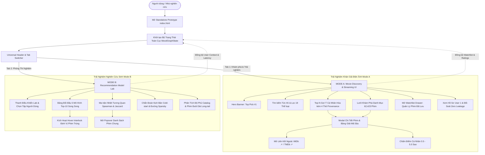
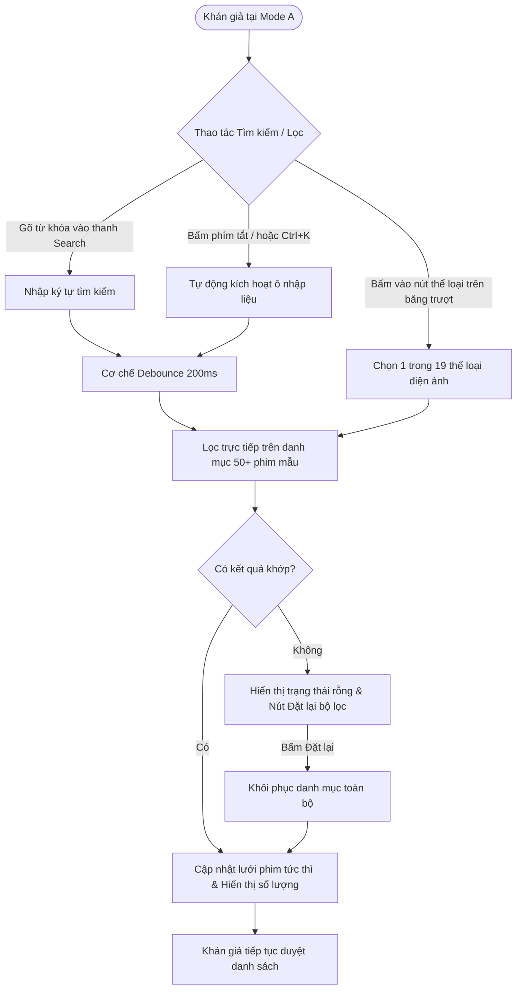
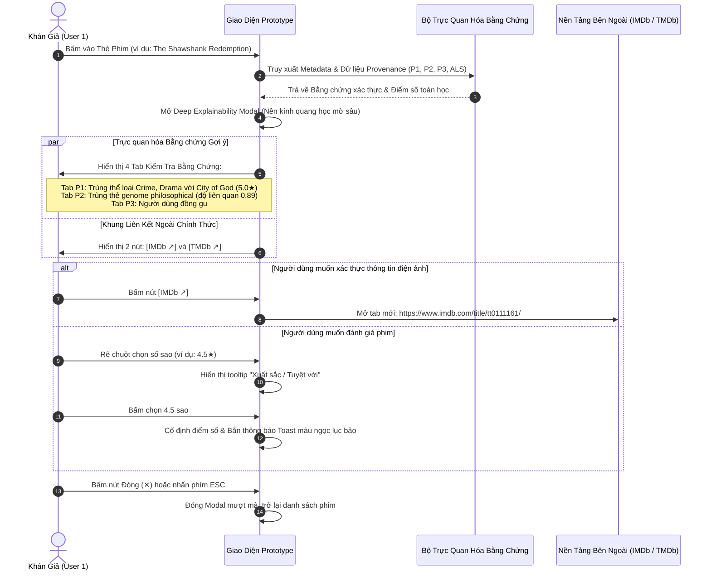
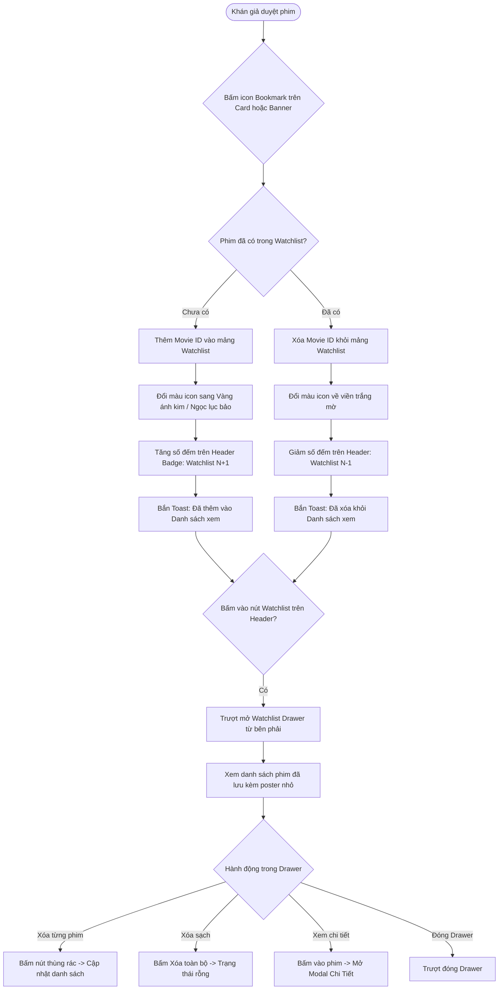
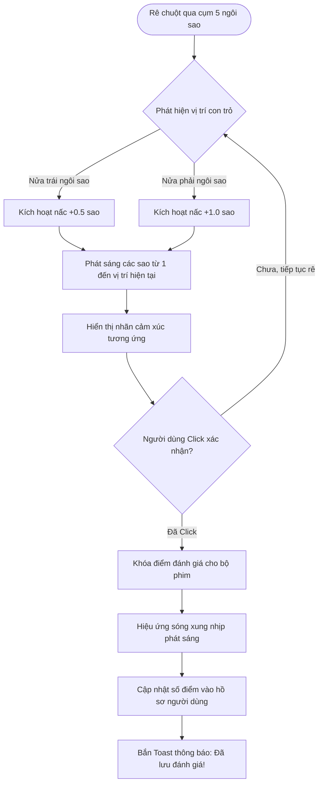
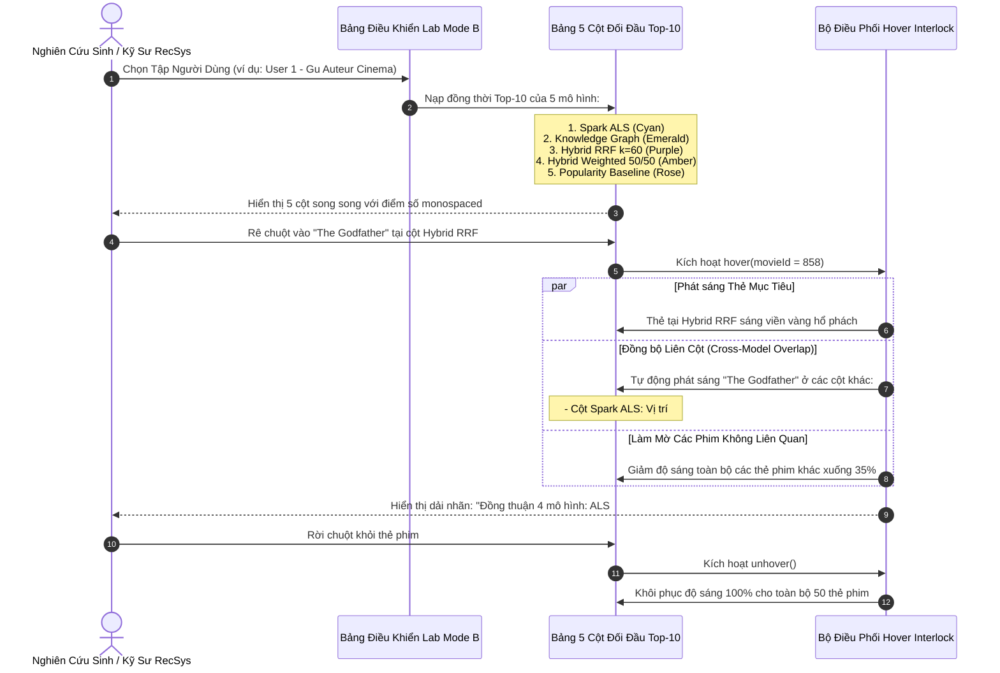
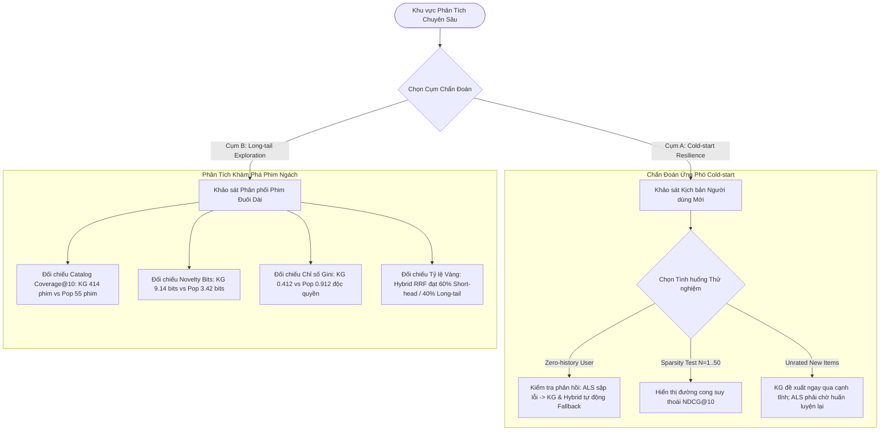

# HỒ SƠ LUỒNG TRẢI NGHIỆM NGƯỜI DÙNG & SƠ ĐỒ TƯƠNG TÁC (USER FLOW & WIREFRAMES)
## Dự Án: MoodGraph Phase 6 — Standalone Interactive Web Prototype
**Tác giả**: Worker 1 - Spec & Mock Data Engineer (Teamwork Subagent)  
**Tập dữ liệu chuẩn**: MovieLens 25M (`ml-25m`) & MoodGraph Knowledge Graph Engine  
**Môi trường đích**: Web Prototype Độc Lập (`MoodGraph/tmp/ui_ux_prototype/`)  
**Quy chuẩn tài liệu**: 100% Tiếng Việt chuẩn ngữ pháp, UTF-8. Không sử dụng ký tự LaTeX hay dấu Dollar ($).  
**Quy chuẩn thuật ngữ**: Thuật ngữ Khoa học Dữ liệu & Hệ Thống Gợi Ý (Recommender Systems / AI Lab). Mode A là "Giao diện Khám Phá & Gợi Ý Phim (Movie Discovery & Streaming UI)", Mode B là "Phòng Thí Nghiệm So Sánh Mô Hình Gợi Ý (Recommendation Model Lab / Benchmark Dashboard)" dành cho nghiên cứu sinh và kỹ sư hệ gợi ý.

---

## 1. TỔNG QUAN KIẾN TRÚC TRẢI NGHIỆM ĐA CHẾ ĐỘ (DUAL-MODE ARCHITECTURE)

Hệ thống giao diện MoodGraph tích hợp hai chế độ trải nghiệm tương tác liền mạch trên cùng một nền tảng client-side duy nhất, chuyển đổi tức thì không tải lại trang thông qua bộ điều khiển trạng thái toàn cục `window.MoodGraphState`:



---

## 2. LUỒNG TRẢI NGHIỆM MODE A: KHÁM PHÁ & GỢI Ý PHIM

### 2.1. Luồng Tìm Kiếm Tức Thì và Băng Lọc 19 Thể Loại
Khán giả có thể tra cứu nhanh danh mục phim thông qua bộ lọc kết hợp không gián đoạn:



### 2.2. Luồng Xem Chi Tiết, Bảng Giải Mã Sâu (4 Thẻ Provenance) và Liên Kết Ngoài
Khi khán giả bấm vào bất kỳ bộ phim nào trong danh mục hoặc bảng gợi ý:



### 2.3. Luồng Quản Lý Danh Sách Xem (Watchlist Management)
Hệ thống quản lý trạng thái xem bền vững trên phiên làm việc:



### 2.4. Luồng Chấm Điểm Phim 0.5 - 5.0 Sao (Interactive Star Rating)
Cơ chế tương tác 10 bậc đánh giá nhạy bén:



---

## 3. LUỒNG TRẢI NGHIỆM MODE B: PHÒNG THÍ NGHIỆM SO SÁNH MÔ HÌNH GỢI Ý

### 3.1. Luồng So Sánh Đối Đầu 5 Mô Hình Top-10 & Kích Hoạt Hover Interlock
Đây là luồng phân tích chuyên sâu của các nghiên cứu sinh và kỹ sư hệ gợi ý:



### 3.2. Luồng Khảo Sát Ma Trận Nhiệt Tương Quan Spearman & Tương Đồng Jaccard
Quy trình hoán đổi ma trận và kiểm tra tính trực giao toán học:

```mermaid
flowchart TD
    StartMatrix([Nghiên cứu sinh tại khu vực Ma trận Nhiệt]) --> ToggleMetric{Bấm nút Hoán Đổi Thước Đo}
    
    ToggleMetric -->|Chọn Spearman Rank Correlation| LoadSpearman[Nạp Ma trận Tương quan Thứ hạng [-1.0, 1.0]]
    ToggleMetric -->|Chọn Jaccard Set Similarity| LoadJaccard[Nạp Ma trận Độ tương đồng Tập hợp [0.0, 1.0]]
    
    subgraph SpearmanRules [Quy tắc Tính Spearman Bắt buộc]
        LoadSpearman --> CheckK{Số phim chung k < 2?}
        CheckK -->|Đúng: k = 0 hoặc k = 1| RenderNull[Hiển thị nhãn null màu xám nhạt]
        CheckK -->|Sai: k >= 2| CalcRelativeRank[Tính trên thứ hạng tương đối 1..k của các phim chung]
        CalcRelativeRank --> RenderDiverging[Áp dụng thang màu phân kỳ: Đỏ âm -> Xám -> Xanh lam -> Lục bảo]
    end

    subgraph JaccardRules [Quy tắc Tính Jaccard]
        LoadJaccard --> CalcJaccard[Tính tỷ lệ: k phim chung / tổng phim độc nhất]
        CalcJaccard --> RenderSequential[Áp dụng thang màu đơn cực: Tím đen -> Xanh Cyan -> Cyan phát quang]
    end

    RenderNull --> GridDisplay[Hiển thị ma trận đối xứng 5x5 hoàn chỉnh]
    RenderDiverging --> GridDisplay
    RenderSequential --> GridDisplay

    GridDisplay --> ClickCell{Bấm vào 1 ô ma trận giao thoa?}
    ClickCell -->|Có| OpenCellPopover[Mở Popover liệt kê đích danh danh sách phim chung & thứ hạng 2 bên]
    ClickCell -->|Không| EndMatrix([Tiếp tục quan sát])
```

### 3.3. Luồng Chẩn Đoán Kịch Bản Cold-Start và Phân Phối Đuôi Dài Long-Tail
Chẩn đoán độ bền vững thuật toán trong điều kiện khắc nghiệt:



---

## 4. SƠ ĐỒ ĐỒNG BỘ TRẠNG THÁI TOÀN CỤC (GLOBAL STATE BRIDGE)

Bản mẫu web tương tác độc lập duy trì tính toàn vẹn trạng thái thông qua đối tượng dùng chung:

```text
window.MoodGraphState = {
  currentUser: {
    userId: 1,
    name: "Alex Turner (Cinephile)",
    ratingsCount: 68,
    meanRating: 3.78,
    activityLevel: "moderate"
  },
  activeMode: "modeA", // "modeA" | "modeB"
  watchlist: [318, 858, 1208], // Danh sách Movie ID đã lưu
  userRatings: {
    318: 5.0,
    858: 4.5,
    79132: 4.5
  },
  activeInterlockMovieId: null, // Movie ID đang được hover phát sáng
  selectedHeatmapMetric: "spearman" // "spearman" | "jaccard"
};
```

---

## 5. BẢN VẼ WIREFRAMES GIAO DIỆN TRỰC QUAN (TEXT / ASCII WIREFRAMES)

### 5.1. Wireframe Mode A: Movie Discovery & Streaming UI
```text
+---------------------------------------------------------------------------------------------------------+
| [MoodGraph Logo]   [Mode A: Khám Phá] [Mode B: Lab]   [Search: '/' hoặc Ctrl+K]   [Watchlist (3)]  [User 1] |
+---------------------------------------------------------------------------------------------------------+
| HERO BANNER: TOP PICK #1 CHO BẠN                                                                        |
| [Backdrop HD độ phân giải cao + Gradient Scrim 3 lớp]                                                  |
| Huy hiệu: [TOP PICK #1] [ĐỘ PHÙ HỢP 98.6%] [HYBRID: SPARK ALS + KNOWLEDGE GRAPH]                        |
|                                                                                                         |
| THE SHAWSHANK REDEMPTION (1994)                                                                         |
| 142 phút • Crime, Drama • IMDb 9.3 ★ • TMDb 8.7 ★                                                       |
| Hành trình kéo dài hai thập kỷ tìm kiếm sự tự do và niềm hy vọng bền bỉ của người tù khổ sai            |
| Andy Dufresne tại nhà tù Shawshank khắc nghiệt...                                                       |
|                                                                                                         |
| [ > Xem Chi Tiết & Bằng Chứng Gợi Ý ]      [ + Lưu vào Watchlist ]                                      |
+---------------------------------------------------------------------------------------------------------+
| CONTROL BAR:                                                                                            |
| Băng Lọc 19 Thể Loại: [Tất cả] [Hành động] [Chính kịch] [Tội phạm] [Khoa học viễn tưởng] ... (Cuộn ngang)|
+---------------------------------------------------------------------------------------------------------+
| GỢI Ý CÁ NHÂN HÓA TOP-N (Dành riêng cho User 1):                                                        |
| +-------------------+  +-------------------+  +-------------------+  +-------------------+              |
| | [P1: THỂ LOẠI]    |  | [P2: TÂM TRẠNG]   |  | [P3: ĐỒNG GU]     |  | [ALS: TIỀM ẨN]    |              |
| | Poster Phim 2:3   |  | Poster Phim 2:3   |  | Poster Phim 2:3   |  | Poster Phim 2:3   |              |
| | The Godfather     |  | Apocalypse Now    |  | Usual Suspects    |  | Schindler's List  |              |
| | 1972 • Crime      |  | 1979 • War        |  | 1995 • Thriller   |  | 1993 • Drama      |              |
| | Match 98.2%       |  | Match 96.5%       |  | Match 95.8%       |  | Match 94.7%       |              |
| | [Chi Tiết] [★]    |  | [Chi Tiết] [★]    |  | [Chi Tiết] [★]    |  | [Chi Tiết] [★]    |              |
| +-------------------+  +-------------------+  +-------------------+  +-------------------+              |
+---------------------------------------------------------------------------------------------------------+
| TOÀN BỘ DANH MỤC 62,423 PHIM (Lưới Lọc & Tìm Kiếm Tức Thì):                                             |
| [Lưới 6 cột thẻ phim linh hoạt, phản hồi tức thì với từ khóa tìm kiếm và nút bấm thể loại]              |
+---------------------------------------------------------------------------------------------------------+
```

### 5.2. Wireframe Modal Chi Tiết Phim & Bảng Giải Mã Sâu
```text
+---------------------------------------------------------------------------------------------------------+
| MODAL CHI TIẾT & BẢNG GIẢI MÃ SÂU (DEEP EXPLAINABILITY INSPECTOR)                                   [✕] |
+---------------------------------------------------+-----------------------------------------------------+
| CỘT TRÁI: POSTER & THÔNG TIN ĐIỆN ẢNH             | CỘT PHẢI: TRUNG TÂM GIẢI MÃ NGUỒN GỐC GỢI Ý         |
|                                                   |                                                     |
| +-------------------------------+                 | THE SHAWSHANK REDEMPTION (1994)                     |
| |                               |                 | Đạo diễn: Frank Darabont • Thời lượng: 142 phút     |
| |                               |                 |                                                     |
| |         POSTER LỚN            |                 | Tóm tắt: Andy Dufresne bị kết án chung thân oan...  |
| |           (2 : 3)             |                 | --------------------------------------------------- |
| |                               |                 | BẢNG KIỂM TRA BẰNG CHỨNG (4 PROVENANCE TABS):       |
| |                               |                 | [ Tab P1 Thể Loại ] [ Tab P2 Tâm Trạng ]            |
| +-------------------------------+                 | [ Tab P3 Đồng Gu  ] [ Tab ALS Vector   ]            |
|                                                   |                                                     |
| LIÊN KẾT NGOÀI CHÍNH THỨC:                        | NỘI DUNG TAB ĐANG CHỌN (P1 Thể Loại):               |
| [ IMDb ↗ (tt0111161) ]  [ TMDb ↗ (278) ]          | - Phim kết nối: "City of God" (Bạn đã chấm 5.0★)    |
|                                                   | - Thể loại giao thoa: Crime, Drama                  |
| CHẤM ĐIỂM PHIM CỦA BẠN:                           | - Trạng thái: VERIFIED_GROUND_TRUTH                 |
| [ ★ ] [ ★ ] [ ★ ] [ ★ ] [ ★ ]  -> 4.5 / 5.0 ★      | - Diễn giải: "Gợi ý vì bạn rất thích các tác phẩm   |
| "Xuất sắc / Tuyệt vời"                            |   thuộc dòng phim Tội phạm & Tâm lý xã hội."        |
+---------------------------------------------------+-----------------------------------------------------+
```

### 5.3. Wireframe Mode B: Recommendation Model Lab / Benchmark Dashboard
```text
+---------------------------------------------------------------------------------------------------------+
| [MoodGraph Logo]   [Mode A: Khám Phá] [Mode B: Lab]   [User: User 1 (Auteur Gu)]   [Latency: 3.08 ms]   |
+---------------------------------------------------------------------------------------------------------+
| LAB CONTROL BAR:                                                                                        |
| Đối Tượng: [User 1 (68 ratings)] [User 2] [User 3] [User 42 Cold-Start] | Bộ Lọc: [Tất cả] [Chỉ Trùng]  |
+---------------------------------------------------------------------------------------------------------+
| BẢNG ĐỐI ĐẦU 5 MÔ HÌNH TOP-10 (HEAD-TO-HEAD PARALLEL VIEW kèm HOVER INTERLOCK):                         |
| +------------------+ +------------------+ +------------------+ +------------------+ +------------------+ |
| | SPARK ALS (Cyan) | | KG GRAPH (Emerald| | HYBRID RRF (Purp)| | WEIGHTED (Amber) | | POPULARITY (Rose)| |
| | Time: 3.28 ms    | | Time: 3.63 ms    | | Time: 3.08 ms    | | Time: 2.88 ms    | | Time: 0.025 ms   | |
| |------------------| |------------------| |------------------| |------------------| |------------------| |
| |#1 Shawshank 4.41 | |#1 Shawshank 0.89 | |#1 Shawshank 0.03 | |#1 Shawshank 0.94 | |#1 Forrest Gump   | |
| |#2 Godfather 4.38*| |#2 Apocalypse 0.84| |#2 Godfather 0.03*| |#2 Godfather 0.91*| |#2 Silence Lambs  | |
| |#3 Usual Susp 4.29| |#3 Ran (1985) 0.82| |#3 Apocalypse 0.02| |#3 Usual Susp 0.88| |#3 The Matrix     | |
| |#4 Schindler 4.25 | |#4 Das Boot 0.79  | |#4 Usual Susp 0.02| |#4 Apocalypse 0.86| |#4 Star Wars IV    | |
| |#5 Godfath.II 4.21| |#5 Yojimbo 0.76   | |#5 Schindler 0.02 | |#5 Schindler 0.85 | |#5 Jurassic Park  | |
| |... (Rank 6..10)  | |... (Rank 6..10)  | |... (Rank 6..10)  | |... (Rank 6..10)  | |... (Rank 6..10)  | |
| |------------------| |------------------| |------------------| |------------------| |------------------| |
| |Nov: 7.85 bits    | |Nov: 9.14 bits    | |Nov: 8.36 bits    | |Nov: 9.02 bits    | |Nov: 3.42 bits    | |
| +------------------+ +------------------+ +------------------+ +------------------+ +------------------+ |
| *Hover Interlock Active: "The Godfather" phát sáng đồng bộ trên cả ALS #2, KG #10, RRF #2, Weighted #2  |
+---------------------------------------------------------------------------------------------------------+
| MA TRẬN TƯƠNG QUAN & ĐỘ TRÙNG LẶP (5x5 HEATMAP MATRIX):       [Toggle: Spearman (rho) | Jaccard Sim]    |
|                    | ALS Cyan | KG Emerald | Hybrid RRF | Weighted Amber | Popularity Rose              |
| Spark ALS          | 1.000    | null (k=0) | +0.6548    | +0.9250        | null (k=0)                   |
| Knowledge Graph    | null     | 1.000      | null (k=2) | null (k=1)     | null (k=0)                   |
| Hybrid RRF         | +0.6548  | null (k=2) | 1.000      | +0.9417        | null (k=0)                   |
| Hybrid Weighted    | +0.9250  | null (k=1) | +0.9417    | 1.000          | null (k=0)                   |
| Popularity Base    | null     | null (k=0) | null (k=0) | null (k=0)     | 1.000                        |
| Ghi chú: k < 2 trả về null theo quy tắc bất biến toán học Spearman (Không bịa đặt số giả).              |
+---------------------------------------------------------------------------------------------------------+
| KHU VỰC PHÂN TÍCH CHUYÊN SÂU:                                                                           |
| [ TAB 1: KHẢ NĂNG ỨNG PHÓ COLD-START ]          | [ TAB 2: PHÂN PHỐI PHIM ĐUÔI DÀI LONG-TAIL ]         |
| - Zero-History User: ALS sập -> KG & Hybrid OK  | - Catalog Coverage@10: KG 414 phim vs Pop 55 phim    |
| - Sparsity Curve: KG bền bỉ ngay cả khi N=1     | - Novelty Score: KG 9.14 bits vs Pop 3.42 bits       |
| - Item Cold-Start: KG giải phóng phim mới 100%  | - Pareto Ratio: Hybrid RRF đạt chuẩn 60/40           |
+---------------------------------------------------------------------------------------------------------+
```
