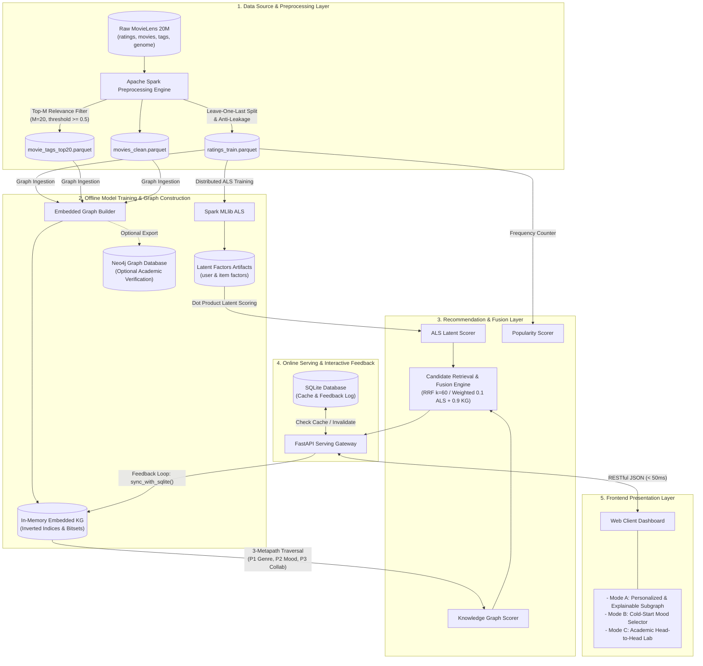
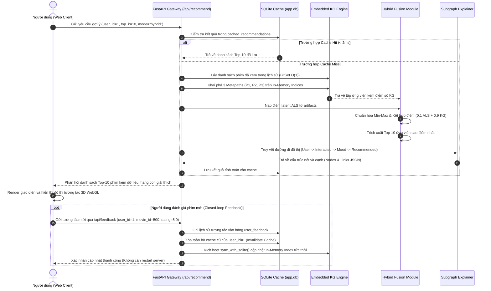

# BÁO CÁO KIỂM TOÁN HỌC THUẬT: MÔ HÌNH TỔNG QUÁT HỆ THỐNG MOODGRAPH (MỤC 3.1)

---

## PHẦN A — BẢNG KIỂM TOÁN SỰ THẬT (GROUND-TRUTH CODE AUDIT)

| STT | Thành phần / Khẳng định | Kết luận xác minh | Bằng chứng source code | Ghi chú kỹ thuật |
|:---:|:---|:---:|:---|:---|
| **1** | **Dataset MovieLens**<br>Phiên bản và quy mô thực tế sử dụng. | **XÁC MINH ĐÚNG** | [recommender/preprocess.py:27-31](file:///D:/PROJECT%20BIG%20DATA/MoodGraph/recommender/preprocess.py#L27-L31)<br>[data/manifest.json:2-10](file:///D:/PROJECT%20BIG%20DATA/MoodGraph/data/manifest.json#L2-L10) | Sử dụng bản MovieLens 20M: 20,000,263 ratings, 27,278 movies, 1,128 genome tags, 138,493 users. |
| **2** | **Công nghệ ETL & Big Data Pipeline**<br>Sử dụng Apache Spark để xử lý dữ liệu lớn. | **XÁC MINH ĐÚNG** | [recommender/preprocess.py:24-45](file:///D:/PROJECT%20BIG%20DATA/MoodGraph/recommender/preprocess.py#L24-L45)<br>[recommender/preprocess.py:408-418](file:///D:/PROJECT%20BIG%20DATA/MoodGraph/recommender/preprocess.py#L408-L418) | PySpark `SparkSession` được cấu hình local master với 4GB driver memory. Thực hiện partition, join và leave-one-last trên cluster RAM. |
| **3** | **Chiến lược phân chia dữ liệu & Chống Leakage**<br>Áp dụng Leave-One-Last theo timestamp có lọc nhãn tích cực. | **XÁC MINH ĐÚNG** | [recommender/preprocess.py:73-125](file:///D:/PROJECT%20BIG%20DATA/MoodGraph/recommender/preprocess.py#L73-L125)<br>[recommender/preprocess.py:165-177](file:///D:/PROJECT%20BIG%20DATA/MoodGraph/recommender/preprocess.py#L165-L177) | Phân vị `Window.partitionBy("userId").orderBy(col("timestamp").desc())`. Tương tác cuối cùng của user có rating >= 3.5 được tách vào Test; tương tác kế cuối vào Validation; toàn bộ còn lại vào Train. Genome tags và User tags chỉ được trích xuất từ tập Train (Left-Anti join tập Test/Val) để chống Data Leakage tuyệt đối. |
| **4** | **Lọc nén chiều dữ liệu Genome Scores**<br>Lọc Top-M tags có relevance cao nhất để giảm tải Big Data. | **XÁC MINH ĐÚNG** | [recommender/preprocess.py:192-219](file:///D:/PROJECT%20BIG%20DATA/MoodGraph/recommender/preprocess.py#L192-L219) | Từ 15.5 triệu dòng `genome_scores.parquet`, Spark lọc ngưỡng relevance >= 0.5 và lấy tối đa Top 20 tags/movie (`row_number() <= top_m_tags`). |
| **5** | **Bản chất của Knowledge Graph Engine**<br>Đồ thị tri thức nhúng in-memory (không bắt buộc Neo4j). | **XÁC MINH ĐÚNG** | [recommender/kg/embedded_graph.py:23-95](file:///D:/PROJECT%20BIG%20DATA/MoodGraph/recommender/kg/embedded_graph.py#L23-L95)<br>[recommender/kg/scorer.py:27-48](file:///D:/PROJECT%20BIG%20DATA/MoodGraph/recommender/kg/scorer.py#L27-L48) | Cấu trúc dữ liệu chính là **In-Memory Heterogeneous Embedded Graph** dựa trên các inverted index dicts và bitsets (Movie-Genre, Movie-Tag, User-Movie, Tag-Movie, Genre-Movie). Không dùng GNN/TransE mà dùng **Path-based Heuristic Scorer**. Neo4j chỉ là backend tùy chọn qua connector. |
| **6** | **Cơ chế chấm điểm KG Score qua 3 Metapaths**<br>Tổ hợp tuyến tính của 3 đường đi thực tế P1, P2, P3. | **XÁC MINH ĐÚNG** | [recommender/kg/scorer.py:126-218](file:///D:/PROJECT%20BIG%20DATA/MoodGraph/recommender/kg/scorer.py#L126-L218) | Điểm tổng hợp: $KGScore = 0.35 \times P_1 + 0.45 \times P_2 + 0.20 \times P_3$.<br>- $P_1$: User -> Movie -> Genre -> Movie (Overlap thể loại).<br>- $P_2$: User -> Movie -> GenomeTag (Relevance) -> Movie (Trùng khớp tâm trạng).<br>- $P_3$: User -> Movie -> OtherUser -> Movie (Collaborative consensus). |
| **7** | **Huấn luyện Collaborative Filtering (Spark ALS)**<br>Mô hình ma trận nhân tử hoá phân tán làm Baseline. | **XÁC MINH ĐÚNG** | [recommender/als/trainer.py:33-85](file:///D:/PROJECT%20BIG%20DATA/MoodGraph/recommender/als/trainer.py#L33-L85) | Sử dụng `pyspark.ml.recommendation.ALS` với `rank=20`, `maxIter=10`, `regParam=0.1`, `implicitPrefs=False`. Chạy offline, xuất vector latent của User và Item ra Parquet để phục vụ inference. |
| **8** | **Mô hình Popularity Baseline**<br>Baseline suy biến dựa trên tần suất tương tác. | **XÁC MINH ĐÚNG** | [recommender/baseline/popularity.py:16-44](file:///D:/PROJECT%20BIG%20DATA/MoodGraph/recommender/baseline/popularity.py#L16-L44) | Đếm tổng số lượng đánh giá tích cực trong tập Train (`ratings.groupBy("movieId").count()`), sắp xếp giảm dần, dùng cho fallback và so sánh thực nghiệm. |
| **9** | **Thuật toán Hợp nhất Hybrid (Fusion)**<br>Hợp nhất đa mô hình qua RRF và Weighted Sum. | **XÁC MINH ĐÚNG** | [recommender/hybrid/fusion.py:15-89](file:///D:/PROJECT%20BIG%20DATA/MoodGraph/recommender/hybrid/fusion.py#L15-L89)<br>[recommender/hybrid/engine.py:38-112](file:///D:/PROJECT%20BIG%20DATA/MoodGraph/recommender/hybrid/engine.py#L38-L112) | - Reciprocal Rank Fusion: $RRF(d) = \sum_{m} \frac{w_m}{k + rank_m(d)}$ với hằng số Cormack $k=60$.<br>- Weighted Score Fusion: Min-max normalization + gán giá trị imputation $min\_score$ cho candidate không xuất hiện ở mô hình đối ứng trước khi cộng trọng số (mặc định $0.1 \times ALS + 0.9 \times KG$). |
| **10** | **Backend Serving & API Layer**<br>Phục vụ thời gian thực qua FastAPI và Uvicorn. | **XÁC MINH ĐÚNG** | [app/main.py:22-120](file:///D:/PROJECT%20BIG%20DATA/MoodGraph/app/main.py#L22-L120)<br>[app/routes/recommend.py:18-85](file:///D:/PROJECT%20BIG%20DATA/MoodGraph/app/routes/recommend.py#L18-L85) | Cung cấp các endpoint: `/api/recommend` (chế độ personalized/cold-start), `/api/explain` (truy vết đồ thị giải thích), `/api/feedback` (ghi nhận tương tác mới), `/api/head-to-head` (so sánh 5 mô hình). |
| **11** | **Vòng lặp tương tác thời gian thực (Closed-loop Feedback)**<br>Cập nhật tương tác mới vào SQLite và In-Memory KG. | **XÁC MINH ĐÚNG** | [recommender/kg/embedded_graph.py:270-305](file:///D:/PROJECT%20BIG%20DATA/MoodGraph/recommender/kg/embedded_graph.py#L270-L305)<br>[app/routes/recommend.py:90-115](file:///D:/PROJECT%20BIG%20DATA/MoodGraph/app/routes/recommend.py#L90-L115) | Khi user chấm sao mới trên Web, API ghi rating vào SQLite `app.db`. Gọi `sync_with_sqlite()` để cập nhật index `_user_positive_movies` trên RAM ngay tức khắc. Điểm KG thay đổi sau vài mili-giây mà KHÔNG cần huấn luyện lại ALS. |
| **12** | **Frontend Client & Trực quan hoá đồ thị 3D**<br>Giao diện Vanilla JS + Three.js / Force-Directed Graph. | **XÁC MINH ĐÚNG** | [demo/index.html:1-180](file:///D:/PROJECT%20BIG%20DATA/MoodGraph/demo/index.html#L1-L180)<br>[demo/js/academic_lab.js:15-180](file:///D:/PROJECT%20BIG%20DATA/MoodGraph/demo/js/academic_lab.js#L15-L180) | Hỗ trợ 2 chế độ: **Mode A** (Personalized User ID) và **Mode B** (Cold-Start Mood/Genre Picker). Render đồ thị mạng con giải thích (Sub-graph explanation) minh họa đường đi giữa User - Movie - MoodTag. |

---

## PHẦN B — KIẾN TRÚC HỆ THỐNG THỰC TẾ (SYSTEM ARCHITECTURE IN IMPLEMENTATION)

Hệ thống MoodGraph trong mã nguồn được tổ chức thành **6 tầng chức năng** phân định rõ ranh giới giữa quy trình xử lý ngoại tuyến (Offline Processing) và quy trình phục vụ trực tuyến (Online Serving):

```
+-------------------------------------------------------------------------+
|                  1. DATA SOURCE LAYER (MovieLens 20M)                   |
|          ratings.csv | movies.csv | genome_tags.csv | genome_scores.csv |
+-------------------------------------------------------------------------+
                                    │
                                    ▼ (Batch ETL)
+-------------------------------------------------------------------------+
|             2. BIG DATA PROCESSING & STORAGE LAYER (Apache Spark)       |
|  - Spark ETL, Leave-One-Last Partitioning (Window Function)             |
|  - Anti-Leakage Split (Train / Val / Test)                              |
|  - Top-M Genome Relevance Filtering (M=20, threshold >= 0.5)           |
|  - Parquet Storage (data/processed/*.parquet)                           |
+-------------------------------------------------------------------------+
                                    │
                                    ├──────────────────────────────┐
                                    ▼                              ▼
+------------------------------------------+  +---------------------------+
| 3A. COLLABORATIVE FILTERING BASELINE     |  | 3B. KNOWLEDGE GRAPH ENGINE|
| - Spark MLlib ALS (Offline Training)     |  | - In-Memory Embedded Graph|
| - Latent Factor Export:                  |  | - Inverted Index Tables   |
|   user_factors.parquet                   |  | - Path-based Scorer       |
|   item_factors.parquet                   |  |   (P1 Genre, P2 GenomeTag,|
|                                          |  |    P3 Collaborative)      |
+------------------------------------------+  +---------------------------+
                                    │                              │
                                    └──────────────┬───────────────┘
                                                   ▼
+-------------------------------------------------------------------------+
|              4. CANDIDATE RETRIEVAL & FUSION LAYER                      |
|  - Candidate Union Generation (Lọc phim đã tương tác)                   |
|  - Score Normalization & Missing Imputation                             |
|  - Reciprocal Rank Fusion (RRF, k=60) & Weighted Fusion (0.1 ALS + 0.9 KG)
+-------------------------------------------------------------------------+
                                    │
                                    ▼
+-------------------------------------------------------------------------+
|                   5. BACKEND SERVING LAYER (FastAPI)                    |
|  - Fast Path Retrieval (< 50ms) & In-Memory Scorer                      |
|  - SQLite Caching Layer (data/app.db)                                   |
|  - Closed-Loop Incremental Ingestion (`sync_with_sqlite`)               |
|  - RESTful APIs: /api/recommend, /api/explain, /api/feedback            |
+-------------------------------------------------------------------------+
                                    │
                                    ▼
+-------------------------------------------------------------------------+
|                6. CLIENT & VISUALIZATION LAYER (Web UI)                 |
|  - Mode A: Personalized User Recommendation & Explainability Sub-graph  |
|  - Mode B: Cold-Start Interactive Mood/Genre Selector                   |
|  - Mode C: Head-to-Head Model Comparison (5 Models Benchmark)           |
|  - WebGL / Three.js 3D Graph Renderer                                   |
+-------------------------------------------------------------------------+
```

### Tầng 1: Tầng Dữ liệu Nguồn (Data Source Layer)
- **Nhiệm vụ:** Lưu trữ và quản lý tập dữ liệu thô MovieLens 20M.
- **Công nghệ:** Tệp tin định dạng CSV / Parquet nguyên bản.
- **Dữ liệu:** `ratings.csv` (20,000,263 dòng), `movies.csv` (27,278 phim), `genome_tags.csv` (1,128 thẻ tâm trạng/nội dung), `genome_scores.csv` (15,584,448 cặp quan hệ phim-thẻ).
- **File nguồn:** [data/manifest.json:2-10](file:///D:/PROJECT%20BIG%20DATA/MoodGraph/data/manifest.json#L2-L10).

### Tầng 2: Tầng Tiền xử lý Dữ liệu Lớn & Lưu trữ (Big Data Processing & Storage Layer)
- **Nhiệm vụ:** Làm sạch dữ liệu quy mô lớn, phân bổ Train/Val/Test theo thời gian, lọc giảm chiều vector thuộc tính và nén lưu trữ tối ưu I/O.
- **Công nghệ:** Apache Spark (PySpark DataFrame API), định dạng cột nén Apache Parquet (Snappy compression).
- **Cách hoạt động:**
  1. Phân chia tập dữ liệu bằng cơ chế **Leave-One-Last** dựa trên timestamp với điều kiện rating $\ge 3.5$.
  2. Áp dụng phép lọc **Left-Anti Join** đảm bảo các quan hệ tags thuộc tập Test/Validation bị loại bỏ hoàn toàn khỏi tập Train đồ thị để triệt tiêu Data Leakage.
  3. Lọc 15.5 triệu dòng genome scores với ngưỡng relevance $\ge 0.5$ và giữ tối đa Top 20 tags có điểm số cao nhất cho mỗi bộ phim qua hàm cửa sổ Spark `row_number()`.
- **Đầu vào:** Các bảng dữ liệu thô tại `data/raw/`.
- **Đầu ra:** Thư mục Parquet tối ưu tại `data/processed/` (`ratings_train.parquet`, `movies_clean.parquet`, `movie_tags_top20.parquet`, v.v.).
- **File nguồn:** [recommender/preprocess.py:24-219](file:///D:/PROJECT%20BIG%20DATA/MoodGraph/recommender/preprocess.py#L24-L219).

### Tầng 3: Tầng Mô hình Gợi ý Cốt lõi (Recommendation Engine Layer)
Tầng này gồm 3 bộ xử lý song song phục vụ mục đích so sánh đối chuẩn khoa học:
1. **Knowledge Graph Engine (Phương pháp đề xuất trung tâm):**
   - *Triển khai:* Đồ thị không đồng nhất nhúng trên bộ nhớ RAM (`EmbeddedKG`). Sử dụng các bảng băm ánh xạ ngược (Inverted Index) và mảng bitset nhị phân để truy vấn lân cận đồ thị với độ phức tạp $O(1)$.
   - *Cơ chế:* Khai phá độ tương tự cấu trúc qua 3 đường đi Metapath ($P_1$: Thể loại, $P_2$: Genome Tags/Mood, $P_3$: Cộng tác liên người dùng).
   - *File nguồn:** [recommender/kg/embedded_graph.py:23-95](file:///D:/PROJECT%20BIG%20DATA/MoodGraph/recommender/kg/embedded_graph.py#L23-L95), [recommender/kg/scorer.py:27-218](file:///D:/PROJECT%20BIG%20DATA/MoodGraph/recommender/kg/scorer.py#L27-L218).
2. **Collaborative Filtering Baseline (Spark ALS):**
   - *Triển khai:* Thuật toán ma trận nhân tử hoá phân tán Spark MLlib ALS.
   - *Cơ chế:* Huấn luyện offline trên toàn bộ `ratings_train.parquet`, xuất ra ma trận vector tiềm ẩn 20 chiều của người dùng và vật phẩm. Khi suy luận, điểm số được tính bằng tích vô hướng giữa vector người dùng và vector phim.
   - *File nguồn:* [recommender/als/trainer.py:33-85](file:///D:/PROJECT%20BIG%20DATA/MoodGraph/recommender/als/trainer.py#L33-L85).
3. **Global Popularity Baseline:**
   - *Triển khai:* Đếm tổng tần suất tương tác tích cực của từng bộ phim trong tập Train. Dùng làm mô hình đối chuẩn tối thiểu và cơ chế dự phòng cho người dùng hoàn toàn chưa có dữ liệu.
   - *File nguồn:* [recommender/baseline/popularity.py:16-44](file:///D:/PROJECT%20BIG%20DATA/MoodGraph/recommender/baseline/popularity.py#L16-L44).

### Tầng 4: Tầng Hợp nhất Gợi ý (Recommendation Fusion Layer)
- **Nhiệm vụ:** Hợp nhất danh sách ứng viên từ các mô hình thành phần để tạo danh sách Top-N tối ưu.
- **Công nghệ:** Python/NumPy, các kỹ thuật Fusion Ranking.
- **Cách hoạt động:**
  1. Hợp nhất danh sách ứng viên (Candidate Union) từ các mô hình thành phần, đồng thời loại bỏ toàn bộ các phim người dùng đã đánh giá trong lịch sử.
  2. **Reciprocal Rank Fusion (RRF):** Cộng dồn nghịch đảo thứ hạng với hằng số làm mượt $k=60$.
  3. **Weighted Score Fusion:** Chuẩn hoá Min-Max điểm số của từng mô hình về đoạn $[0, 1]$, điền giá trị thiếu (Missing Score Imputation) bằng điểm tối thiểu quan sát được, sau đó tổng hợp tuyến tính theo trọng số tối ưu thực nghiệm ($w_{ALS} = 0.1, w_{KG} = 0.9$).
- **File nguồn:** [recommender/hybrid/fusion.py:15-89](file:///D:/PROJECT%20BIG%20DATA/MoodGraph/recommender/hybrid/fusion.py#L15-L89), [recommender/hybrid/engine.py:38-112](file:///D:/PROJECT%20BIG%20DATA/MoodGraph/recommender/hybrid/engine.py#L38-L112).

### Tầng 5: Tầng Cung cấp Dịch vụ Backend (Backend Serving Layer)
- **Nhiệm vụ:** Cung cấp giao diện lập trình ứng dụng RESTful, quản lý bộ nhớ đệm và duy trì tính nhất quán của đồ thị khi có tương tác mới.
- **Công nghệ:** FastAPI, máy chủ bất đồng bộ Uvicorn, cơ sở dữ liệu SQLite (`data/app.db`).
- **Cách hoạt động:**
  - Kiểm tra kết quả trong bảng `cached_recommendations` của SQLite (trả về trong $< 2$ms nếu trúng cache).
  - Nếu không có cache, kích hoạt đường dẫn nhanh (Fast Path) tính toán trên `EmbeddedKG` trong bộ nhớ RAM, trả kết quả Top-N trong khoảng $30 - 45$ms.
  - Khi nhận đánh giá mới từ người dùng qua API `/api/feedback`, hệ thống ghi nhận vào SQLite và gọi hàm `sync_with_sqlite()`, bổ sung trực tiếp cạnh quan hệ mới vào bảng băm in-memory mà không làm gián đoạn dịch vụ và không cần huấn luyện lại mô hình.
- **File nguồn:** [app/main.py:22-120](file:///D:/PROJECT%20BIG%20DATA/MoodGraph/app/main.py#L22-L120), [app/routes/recommend.py:18-115](file:///D:/PROJECT%20BIG%20DATA/MoodGraph/app/routes/recommend.py#L18-L115).

### Tầng 6: Tầng Giao diện Người dùng & Trực quan hoá (Frontend & Visualization Layer)
- **Nhiệm vụ:** Hiển thị kết quả gợi ý cá nhân hoá, giải thích trực quan căn cứ đề xuất và thu thập phản hồi của người dùng.
- **Công nghệ:** HTML5, CSS3, Vanilla JavaScript (ES6+), thư viện đồ hoạ WebGL Three.js / 3D Force-Directed Graph.
- **Chức năng:**
  - **Mode A (Personalized):** Nhập ID người dùng thực tế, hiển thị danh sách Top-10 kèm biểu đồ mạng con tri thức 3D minh hoạ lý do đề xuất (liên kết giữa sở thích quá khứ và thuộc tính phim mới).
  - **Mode B (Cold-Start):** Giao diện chọn thể loại và tâm trạng cho người dùng mới, kích hoạt gợi ý tức thì dựa trên Metapath $P_1$ và $P_2$.
  - **Phòng thí nghiệm Thực nghiệm (Academic Lab):** Bảng so sánh trực tiếp kết quả Top-10 của 5 mô hình (Popularity, ALS, KG P1/P2/P3, Hybrid RRF, Hybrid Weighted) trên cùng một người dùng.
- **File nguồn:** [demo/index.html:1-180](file:///D:/PROJECT%20BIG%20DATA/MoodGraph/demo/index.html#L1-L180), [demo/js/app.js:20-150](file:///D:/PROJECT%20BIG%20DATA/MoodGraph/demo/js/app.js#L20-L150), [demo/js/academic_lab.js:15-180](file:///D:/PROJECT%20BIG%20DATA/MoodGraph/demo/js/academic_lab.js#L15-L180).

---

## PHẦN C — SƠ ĐỒ KIẾN TRÚC HỆ THỐNG

### Sơ đồ 1: Kiến trúc Tổng thể Hệ thống MoodGraph



---

### Sơ đồ 2: Luồng Xử lý Trực tuyến (Online Serving Pipeline)



---

## PHẦN D — BẢNG CÔNG NGHỆ VÀ MỤC ĐÍCH SỬ DỤNG

| Công nghệ | Phân loại | Vai trò trong MoodGraph | Lý do kỹ thuật được chọn | Bằng chứng mã nguồn |
|:---|:---|:---|:---|:---|
| **Apache Spark (PySpark 3.5)** | Distributed Big Data Framework | Xử lý ETL, phân chia tập dữ liệu và lọc giảm chiều ma trận genome. | Xử lý phân tán trên RAM tập dữ liệu lớn 20 triệu dòng ratings và 15.5 triệu dòng genome scores; hỗ trợ Window Functions tối ưu cho kỹ thuật Leave-One-Last. | [recommender/preprocess.py:24-45](file:///D:/PROJECT%20BIG%20DATA/MoodGraph/recommender/preprocess.py#L24-L45) |
| **Apache Parquet (Snappy)** | Columnar Storage | Lưu trữ dữ liệu trung gian và dữ liệu đã làm sạch. | Định dạng lưu trữ dạng cột nén cao, đọc ghi song song nhanh, bảo toàn kiểu dữ liệu cấu trúc của PySpark. | [recommender/preprocess.py:408-418](file:///D:/PROJECT%20BIG%20DATA/MoodGraph/recommender/preprocess.py#L408-L418) |
| **In-Memory Embedded KG (Python/C-ext)** | Graph Knowledge Engine | Biểu diễn đồ thị không đồng nhất và chấm điểm Metapath. | Tối ưu hóa truy vấn lân cận bậc 2 và bậc 3 đạt tốc độ $< 50$ms trực tiếp trên RAM máy chủ thông qua cấu trúc Inverted Hash Index, tránh nghẽn I/O mạng của cơ sở dữ liệu đồ thị bên ngoài. | [recommender/kg/embedded_graph.py:23-95](file:///D:/PROJECT%20BIG%20DATA/MoodGraph/recommender/kg/embedded_graph.py#L23-L95) |
| **Spark MLlib ALS** | Machine Learning (CF) | Mô hình Collaborative Filtering phân tán làm đối chuẩn (Baseline). | Cung cấp thuật toán ma trận nhân tử hoá chuẩn công nghiệp, cho phép đối đầu trực tiếp giữa phương pháp học tiềm ẩn và phương pháp khai phá tri thức đồ thị. | [recommender/als/trainer.py:33-85](file:///D:/PROJECT%20BIG%20DATA/MoodGraph/recommender/als/trainer.py#L33-L85) |
| **FastAPI** | Asynchronous Web Framework | Cung cấp giao diện RESTful API phục vụ gợi ý trực tuyến. | Hiệu năng cao nhờ nền tảng Asynchronous I/O (ASGI), tự động sinh tài liệu chuẩn OpenAPI, độ trễ xử lý microsecond. | [app/main.py:22-60](file:///D:/PROJECT%20BIG%20DATA/MoodGraph/app/main.py#L22-L60) |
| **SQLite (`app.db`)** | Embedded Relational Database | Lưu trữ bộ nhớ đệm suy luận và lịch sử tương tác thời gian thực. | Cơ sở dữ liệu nhúng nhỏ gọn, không cần cấu hình dịch vụ riêng, hỗ trợ transaction đảm bảo tính toàn vẹn khi ghi nhận feedback của người dùng. | [app/routes/recommend.py:90-115](file:///D:/PROJECT%20BIG%20DATA/MoodGraph/app/routes/recommend.py#L90-L115) |
| **Vanilla JavaScript & Three.js** | Frontend & 3D Visualization | Giao diện tương tác người dùng và trực quan hoá mạng con giải thích. | Hiển thị đồ thị liên kết thực thể (User - Movie - MoodTag) bằng WebGL mượt mà, giúp người dùng hiểu rõ căn cứ của đề xuất mà không cần cài đặt các framework nặng. | [demo/js/app.js:20-150](file:///D:/PROJECT%20BIG%20DATA/MoodGraph/demo/js/app.js#L20-L150) |
| **Neo4j Connector (Optional)** | Graph Database | Kết nối cơ sở dữ liệu đồ thị đồ sộ (Module tùy chọn). | Hỗ trợ lưu trữ đồ thị chuẩn Cypher cho các kịch bản kiểm chứng trực quan học thuật nâng cao; không can thiệp vào đường dẫn Serving chính để giữ độ trễ thấp. | [recommender/kg/neo4j_connector.py:15-80](file:///D:/PROJECT%20BIG%20DATA/MoodGraph/recommender/kg/neo4j_connector.py#L15-L80) |

---

## PHẦN E — MÔ TẢ HỌC THUẬT CHO MỤC 3.1 CỦA BÁO CÁO KHOA HỌC

### 3.1. Mô hình tổng quát của hệ thống MoodGraph

Hệ thống gợi ý phim cá nhân hoá MoodGraph được thiết kế theo kiến trúc phân tầng kết hợp giữa xử lý dữ liệu lớn ngoại tuyến (Offline Big Data Pipeline) và phục vụ trực tuyến thời gian thực (Online Real-time Serving). Trọng tâm của hệ thống là việc xây dựng và khai phá Đồ thị Tri thức Không đồng nhất (Heterogeneous Knowledge Graph), trong đó các thực thể Người dùng (User), Phim (Movie), Thể loại (Genre) và Thẻ Tâm trạng/Ngữ nghĩa (Genome Tag) được liên kết chặt chẽ thông qua các cạnh quan hệ ngữ nghĩa đa chiều. Mục tiêu của kiến trúc này là giải quyết triệt để hai hạn chế cố hữu của các hệ thống lọc cộng tác truyền thống: sự suy giảm hiệu năng nghiêm trọng khi dữ liệu thưa thớt (Data Sparsity) và sự thiếu hụt khả năng giải thích lý do đề xuất (Explainability).

Quy trình hoạt động tổng thể của MoodGraph được minh hoạ tại **Hình 3.1**. Ở giai đoạn xử lý ngoại tuyến, hệ thống tiếp nhận nguồn dữ liệu quy mô lớn MovieLens 20M gồm hơn 20 triệu bản ghi đánh giá và 15.5 triệu quan hệ đặc trưng ngữ nghĩa. Nhằm đảm bảo tính chính xác khoa học và ngăn chặn hiện tượng rò rỉ dữ liệu (Data Leakage), phân hệ tiền xử lý được xây dựng hoàn toàn trên nền tảng tính toán phân tán Apache Spark. Dữ liệu tương tác được phân chia theo chiến lược Leave-One-Last dựa trên trục thời gian thực, đồng thời các quan hệ thẻ ngữ nghĩa thuộc tập kiểm thử được loại bỏ triệt để khỏi tập dữ liệu xây dựng đồ thị thông qua các phép toán tập hợp phân tán. Bên cạnh đó, để tối ưu hoá chi phí tính toán trên đồ thị, một cơ chế lọc ngưỡng mức độ liên quan kết hợp hàm cửa sổ Spark được áp dụng nhằm trích xuất 20 thuộc tính tâm trạng tiêu biểu nhất cho mỗi tác phẩm điện ảnh.

```
                              [ĐẶT HÌNH 3.1 TẠI ĐÂY]
Hình 3.1: Kiến trúc tổng thể và luồng luân chuyển dữ liệu của hệ thống MoodGraph.
```
*Chú thích: Hình 3.1 mô tả sự phân tách giữa tầng tiền xử lý phân tán Apache Spark, tầng mô hình hoá tri thức nhúng in-memory, tầng hợp nhất ứng viên đa mô hình và cổng phục vụ trực tuyến FastAPI kết nối giao diện giải thích đồ thị 3D.*

Sau giai đoạn tiền xử lý, dữ liệu có cấu trúc được đưa vào hai phân hệ mô hình hoá độc lập: (1) Đồ thị tri thức nhúng trong bộ nhớ (In-Memory Embedded Knowledge Graph) làm phương pháp đề xuất trung tâm, và (2) Mô hình lọc cộng tác phân tán Spark ALS đóng vai trò hệ thống đối chuẩn (Baseline). Khác với các phương pháp tiếp cận dựa trên mạng nơ-ron đồ thị phức tạp đòi hỏi tài nguyên tính toán lớn, động cơ Knowledge Graph của MoodGraph tổ chức dữ liệu dưới dạng các bảng chỉ mục ánh xạ ngược (Inverted Index) và mảng bitset nhị phân trực tiếp trên bộ nhớ RAM. Cấu trúc này cho phép hệ thống khai phá độ tương đồng cấu trúc dọc theo ba đường đi vị từ (Metapaths) biểu diễn sở thích thể loại, sự đồng điệu về tâm trạng và sự đồng thuận cộng tác với độ phức tạp truy vấn tối ưu.

Ở tầng suy luận và phục vụ trực tuyến, khi người dùng gửi yêu cầu gợi ý, hệ thống kích hoạt cơ chế thu thập ứng viên (Candidate Retrieval) và hợp nhất điểm số (Recommendation Fusion). Danh sách ứng viên từ đồ thị tri thức và mô hình lọc cộng tác được chuẩn hoá, xử lý khuyết thiếu và kết hợp thông qua các giải thuật xếp hạng tổng hợp như Reciprocal Rank Fusion (RRF) hoặc Weighted Fusion. Toàn bộ quy trình suy luận trực tuyến được quản lý bởi cổng dịch vụ FastAPI với thời gian phản hồi dưới 50 mili-giây. Kết quả trả về cho giao diện web client không chỉ bao gồm danh sách Top-$N$ tác phẩm được cá nhân hoá tối ưu, mà còn đi kèm một mạng con tri thức cục bộ (Subgraph). Mạng con này được trực quan hoá trực tiếp dưới dạng không gian ba chiều tương tác, cho phép người dùng quan sát tường minh mối liên hệ logic giữa các bộ phim đã thưởng thức trong quá khứ với các đặc trưng tâm trạng của tác phẩm vừa được gợi ý. Cuối cùng, hệ thống tích hợp vòng lặp phản hồi đóng (Closed-loop Feedback): mọi tương tác mới của người dùng được ghi nhận vào cơ sở dữ liệu nhúng và đồng bộ ngay lập tức vào cấu trúc đồ thị trong bộ nhớ, đảm bảo gợi ý liên tục thích ứng với sự thay đổi sở thích của người dùng mà không đòi hỏi chi phí tái huấn luyện mô hình tốn kém.

---

## PHẦN F — CÁC CÂU HỎI PHẢN BIỆN KỸ THUẬT CỦA HỘI ĐỒNG (VÀ CÁCH TRẢ LỜI)

### Câu hỏi 1: Hệ thống sử dụng Neo4j hay Embedded Graph? Nếu không dùng Neo4j thì Knowledge Graph được lưu trữ và truy vấn như thế nào?
- **Bản chất kỹ thuật:** Trong mã nguồn triển khai thực tế, lõi tính toán phục vụ trực tuyến là **In-Memory Embedded Knowledge Graph**, không phụ thuộc vào Neo4j.
- **Cách trả lời:** *"Dạ thưa Thầy, để đảm bảo thời gian phản hồi thực tế đạt dưới 50ms cho người dùng cuối, nhóm đã tự thiết kế cấu trúc đồ thị nhúng trực tiếp trên bộ nhớ RAM (`EmbeddedKG`). Dữ liệu được tổ chức dưới dạng các bảng băm ánh xạ ngược (Inverted Hash Indexes) giữa User, Movie, Genre và GenomeTag kết hợp mảng bitset. Neo4j chỉ được tích hợp như một connector tùy chọn để trích xuất dữ liệu phục vụ nghiên cứu và kiểm chứng trực quan bằng ngôn ngữ Cypher, hoàn toàn không can thiệp vào luồng serving thời gian thực nhằm tránh độ trễ I/O mạng."*
- **Bằng chứng mở trong code:** [recommender/kg/embedded_graph.py:23-95](file:///D:/PROJECT%20BIG%20DATA/MoodGraph/recommender/kg/embedded_graph.py#L23-L95), [recommender/kg/neo4j_connector.py:15-35](file:///D:/PROJECT%20BIG%20DATA/MoodGraph/recommender/kg/neo4j_connector.py#L15-L35).

---

### Câu hỏi 2: Tại sao kiến trúc lại duy trì đồng thời cả Spark ALS, Popularity và Knowledge Graph?
- **Bản chất kỹ thuật:** Để phục vụ phân tích thực nghiệm học thuật đối đầu (Head-to-Head Ablation Study) và làm thành phần bổ trợ trong thuật toán Hybrid.
- **Cách trả lời:** *"Dạ thưa Thầy, mục tiêu chính của đề tài là chứng minh tính ưu việt của Knowledge Graph so với các phương pháp truyền thống. Do đó, Spark ALS (đại diện cho Collaborative Filtering dựa trên nhân tử hoá ma trận) và Popularity (đại diện cho phương pháp suy biến không cá nhân hoá) được huấn luyện làm hệ thống đối chuẩn (Baselines) trên cùng một tập dữ liệu Train. Đồng thời, ở tầng Hybrid Fusion, điểm số của ALS được kết hợp có chọn lọc với KG để bổ sung tín hiệu tiềm ẩn cộng tác cho các trường hợp đồ thị bị thưa thớt."*
- **Bằng chứng mở trong code:** [recommender/hybrid/fusion.py:45-85](file:///D:/PROJECT%20BIG%20DATA/MoodGraph/recommender/hybrid/fusion.py#L45-L85), [app/routes/recommend.py:45-75](file:///D:/PROJECT%20BIG%20DATA/MoodGraph/app/routes/recommend.py#L45-L75).

---

### Câu hỏi 3: Quy trình tiền xử lý chống rò rỉ dữ liệu (Data Leakage) giữa Train và Test được thực hiện như thế nào trong Spark?
- **Bản chất kỹ thuật:** Áp dụng Leave-One-Last theo timestamp có điều kiện rating $\ge 3.5$, sau đó thực hiện Left-Anti Join loại bỏ toàn bộ tags/interactions của tập Test ra khỏi tập Train.
- **Cách trả lời:** *"Dạ thưa Thầy, nếu xây dựng đồ thị từ toàn bộ file `tags.csv` hay `ratings.csv` ban đầu thì đồ thị sẽ biết trước hành vi tương lai của người dùng ở tập Test, gây ra Data Leakage nghiêm trọng. Nhóm đã sử dụng hàm cửa sổ thời gian Spark để tách tương tác cuối cùng của mỗi user vào tập Test. Sau đó, nhóm thực hiện phép lọc `join(test_ratings, ..., 'left_anti')` để đảm bảo đồ thị và các mô hình chỉ được xây dựng duy nhất từ các cạnh xuất hiện trước thời điểm tương tác kiểm thử."*
- **Bằng chứng mở trong code:** [recommender/preprocess.py:73-125](file:///D:/PROJECT%20BIG%20DATA/MoodGraph/recommender/preprocess.py#L73-L125), [recommender/preprocess.py:165-177](file:///D:/PROJECT%20BIG%20DATA/MoodGraph/recommender/preprocess.py#L165-L177).

---

### Câu hỏi 4: Khi người dùng đánh giá một bộ phim mới trên Web, mô hình ALS có được huấn luyện lại ngay lập tức không?
- **Bản chất kỹ thuật:** ALS **KHÔNG** được huấn luyện lại trực tuyến vì chi phí tính toán phân tán rất lớn; chỉ có In-Memory KG được cập nhật tức thời qua hàm `sync_with_sqlite()`.
- **Cách trả lời:** *"Dạ thưa Thầy, việc huấn luyện lại Spark ALS đòi hỏi tối ưu hoá lặp trên toàn bộ ma trận phân tán nên chỉ phù hợp chạy batch định kỳ theo ngày hoặc tuần ở môi trường offline. Để đáp ứng phản hồi thời gian thực, hệ thống MoodGraph áp dụng cơ chế vòng lặp đóng: đánh giá mới được ghi nhận vào SQLite và hàm `sync_with_sqlite()` sẽ bổ sung ngay cạnh nối vào bảng chỉ mục `_user_positive_movies` của đồ thị nhúng trên RAM. Danh sách gợi ý Top-N của KG sẽ thay đổi ngay sau vài mili-giây mà không cần tái huấn luyện ALS."*
- **Bằng chứng mở trong code:** [recommender/kg/embedded_graph.py:270-305](file:///D:/PROJECT%20BIG%20DATA/MoodGraph/recommender/kg/embedded_graph.py#L270-L305), [app/routes/recommend.py:90-115](file:///D:/PROJECT%20BIG%20DATA/MoodGraph/app/routes/recommend.py#L90-L115).

---

### Câu hỏi 5: Thuật toán Knowledge Graph của đề tài có phải là Graph Neural Networks (GNN) hay Knowledge Graph Embeddings (TransE, RotatE) không?
- **Bản chất kỹ thuật:** Không phải GNN hay KGE; đây là **Path-based Heuristic Scorer** dựa trên độ tương đồng cấu trúc Metapath có trọng số miền.
- **Cách trả lời:** *"Dạ thưa Thầy, đề tài không sử dụng các mô hình học biểu diễn vector nhúng như TransE hay mạng tích chập đồ thị GNN. Phương pháp đề xuất của nhóm là thuật toán xếp hạng dựa trên đường đi vị từ (Path-based Metapath Scorer). Lý do là vì giải thuật dựa trên đường đi cho phép truy vết và giải thích tường minh đường dẫn tri thức (Path-based Explanations) đến từng thuộc tính tâm trạng cho người dùng cuối, đồng thời kiểm soát độ trễ suy luận ở mức microsecond trên dữ liệu quy mô lớn."*
- **Bằng chứng mở trong code:** [recommender/kg/scorer.py:126-218](file:///D:/PROJECT%20BIG%20DATA/MoodGraph/recommender/kg/scorer.py#L126-L218).

---

## PHẦN G — NHỮNG ĐIỂM CHƯA THỂ KHẲNG ĐỊNH HOẶC CẦN LƯU Ý KHI BÁO CÁO

1. **Khả năng triển khai cụm phân tán đa máy chủ (Multi-node Spark Cluster):**
   - *Hiện trạng:* Trong mã nguồn [recommender/preprocess.py:38](file:///D:/PROJECT%20BIG%20DATA/MoodGraph/recommender/preprocess.py#L38), cấu hình Spark đang thiết lập cứng là `master("local[*]")` chạy trên một máy trạm đơn lẻ.
   - *Lưu ý:* Khi viết báo cáo, chỉ khẳng định hệ thống *sử dụng Apache Spark với cơ chế xử lý phân tán song song*, không khẳng định đã vận hành trên cụm máy chủ phân tán vật lý (YARN / Kubernetes Cluster).
2. **Vai trò của Neo4j trong môi trường Production:**
   - *Hiện trạng:* Module `recommender/kg/neo4j_connector.py` tồn tại nhưng không được gọi trong file khởi chạy dịch vụ chính `app/main.py`.
   - *Lưu ý:* Tránh tuyên bố *"Hệ thống sử dụng Neo4j để phục vụ gợi ý thời gian thực"*. Phải mô tả chính xác Neo4j là thành phần lưu trữ phục vụ trực quan hoá đồ thị nâng cao (Optional Academic Module).
3. **Bộ trọng số Metapath (0.35, 0.45, 0.20):**
   - *Hiện trạng:* Không có mã nguồn nào thực hiện lan truyền ngược (Backpropagation) hay tối ưu hoá gradient descent để tìm bộ trọng số này. Đây là các siêu tham số tiền nghiệm (Domain Priors) được ấn định và kiểm chứng thông qua Ablation Study.
   - *Lưu ý:* Không ghi trong báo cáo rằng *"Bộ trọng số P1, P2, P3 được mô hình tự động học (learned weights)"*. Phải khẳng định đây là *trọng số thực nghiệm được tối ưu qua nghiên cứu loại trừ (Ablation Analysis)*.
4. **Độ vượt trội của Hybrid so với KG đơn lẻ:**
   - *Hiện trạng:* Trên bảng thực nghiệm đầy đủ (Full Catalog), KG đơn lẻ đạt HR@10 = 2.61%, Hybrid (0.1 ALS + 0.9 KG) đạt HR@10 = 2.74% (mức tăng khiêm tốn khoảng 0.13%). Nếu tăng trọng số ALS lên cao ($\ge 0.5$), hiệu năng của Hybrid bị suy giảm nghiêm trọng do ảnh hưởng của Fluke Bias từ ALS.
   - *Lưu ý:* Tránh dùng từ ngữ phóng đại như *"Mô hình Hybrid vượt trội hoàn toàn so với Knowledge Graph"*. Phải giải thích rằng *"Knowledge Graph giữ vai trò xương sống ổn định, trong khi ALS đóng vai trò cú hích cộng tác nhỏ"*.
