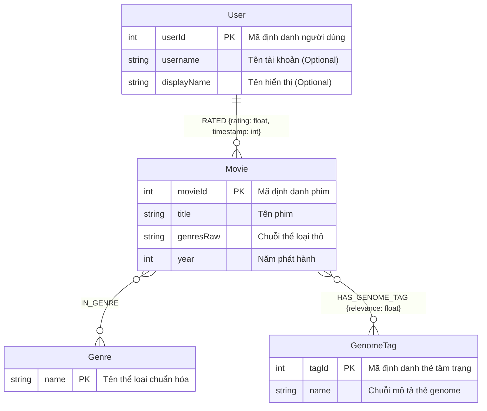

# BÁO CÁO KIỂM TOÁN HỌC THUẬT: MỤC 3.2.1
## LƯỢC ĐỒ THỰC THỂ VÀ QUAN HỆ: USER – MOVIE – GENRE – GENOMETAG

---

## PHẦN A — BẢNG KIỂM TOÁN THỰC THỂ (NODE AUDIT)

Hệ thống đồ thị MoodGraph trong mã nguồn triển khai thực tế có đúng **4 loại thực thể (Nodes)**:

| Loại Node | Ý nghĩa trong hệ thống | Khóa định danh duy nhất (Identifier) | Thuộc tính thực sự lưu trong RAM (`EmbeddedKG`) | Thuộc tính có ở dữ liệu nguồn nhưng không lưu trong KG RAM | Bằng chứng mã nguồn |
| :--- | :--- | :--- | :--- | :--- | :--- |
| **`User`** | Người dùng đánh giá và tiêu thụ nội dung điện ảnh. | `userId` (`int`) | - `userId` (`int`) - `metadata`: `username`, `displayName` (nếu đồng bộ từ SQLite). | `timestamp` tương tác (chỉ lưu trên cạnh đánh giá). | [recommender/kg/embedded_graph.py:31](file:///D:/PROJECT%20BIG%20DATA/MoodGraph/recommender/kg/embedded_graph.py#L31) [recommender/kg/embedded_graph.py:67-72](file:///D:/PROJECT%20BIG%20DATA/MoodGraph/recommender/kg/embedded_graph.py#L67-L72) [recommender/kg/schema.cypher:6-7](file:///D:/PROJECT%20BIG%20DATA/MoodGraph/recommender/kg/schema.cypher#L6-L7) |
| **`Movie`** | Tác phẩm điện ảnh (vật phẩm được khuyến nghị). | `movieId` (`int`) | - `movieId` (`int`) - `title` (`str`) - `genresRaw` (`str`) - `year` (`Optional[int]`) | `imdbId`, `tmdbId` (từ `links.csv`, chỉ lưu trong Parquet core). | [recommender/kg/embedded_graph.py:32](file:///D:/PROJECT%20BIG%20DATA/MoodGraph/recommender/kg/embedded_graph.py#L32) [recommender/kg/embedded_graph.py:73-87](file:///D:/PROJECT%20BIG%20DATA/MoodGraph/recommender/kg/embedded_graph.py#L73-L87) [recommender/kg/schema.cypher:9-11](file:///D:/PROJECT%20BIG%20DATA/MoodGraph/recommender/kg/schema.cypher#L9-L11) |
| **`Genre`** | Thể loại phim chuẩn hóa (Action, Comedy, Drama...). | `name` (`str`) | `name` (`str`) | Không có. | [recommender/kg/embedded_graph.py:33](file:///D:/PROJECT%20BIG%20DATA/MoodGraph/recommender/kg/embedded_graph.py#L33) [recommender/kg/embedded_graph.py:88-93](file:///D:/PROJECT%20BIG%20DATA/MoodGraph/recommender/kg/embedded_graph.py#L88-L93) [recommender/kg/schema.cypher:13-15](file:///D:/PROJECT%20BIG%20DATA/MoodGraph/recommender/kg/schema.cypher#L13-L15) |
| **`GenomeTag`** | Thẻ đặc trưng ngữ nghĩa / tâm trạng chuẩn hóa (1,128 thẻ từ Genome). | `tagId` (`int`) | - `tagId` (`int`) - `name` (`str`) (chuỗi tên tag, ví dụ: "atmospheric", "dark humor"). | Không có. | [recommender/kg/embedded_graph.py:34](file:///D:/PROJECT%20BIG%20DATA/MoodGraph/recommender/kg/embedded_graph.py#L34) [recommender/kg/embedded_graph.py:94-99](file:///D:/PROJECT%20BIG%20DATA/MoodGraph/recommender/kg/embedded_graph.py#L94-L99) [recommender/kg/schema.cypher:17-19](file:///D:/PROJECT%20BIG%20DATA/MoodGraph/recommender/kg/schema.cypher#L17-L19) |

---

## PHẦN B — BẢNG KIỂM TOÁN QUAN HỆ (EDGE AUDIT)

Đồ thị MoodGraph có đúng **3 loại quan hệ ngữ nghĩa (Edges)**. Trong mã nguồn `EmbeddedKnowledgeGraph`, mọi quan hệ đều được duy trì dưới dạng **cặp chỉ mục đảo hai chiều (Inverted Index Pairs)** trên RAM để truy vấn theo cả hai hướng với độ phức tạp $O(1)$:

| Tên Edge | Node nguồn ($\mathcal{V}_{src}$) | Node đích ($\mathcal{V}_{dst}$) | Ý nghĩa ngữ nghĩa | Thuộc tính cạnh (Edge Properties) | Cấu trúc lưu trữ hai chiều trong mã nguồn | Bằng chứng mã nguồn |
| :--- | :--- | :--- | :--- | :--- | :--- | :--- |
| **`RATED`** | `User` | `Movie` | Người dùng đánh giá mức độ yêu thích một bộ phim. | - `rating`: `float` (từ 0.5 đến 5.0) - `timestamp`: `int` (mốc thời gian POSIX) | - Forward: `self.user_rated_movie[uid][mid] = {"rating": r, "timestamp": ts}` - Reverse: `self.movie_rated_by_users[mid][uid] = {"rating": r, "timestamp": ts}` | [recommender/kg/embedded_graph.py:38-41](file:///D:/PROJECT%20BIG%20DATA/MoodGraph/recommender/kg/embedded_graph.py#L38-L41) [recommender/kg/embedded_graph.py:120-132](file:///D:/PROJECT%20BIG%20DATA/MoodGraph/recommender/kg/embedded_graph.py#L120-L132) |
| **`IN_GENRE`** | `Movie` | `Genre` | Phim thuộc về một hoặc nhiều thể loại. | Không có thuộc tính (Quan hệ nhị phân thuần túy $0/1$). | - Forward: `self.movie_in_genre[mid] = Set[str]` - Reverse: `self.genre_to_movies[genre] = Set[int]` | [recommender/kg/embedded_graph.py:43-45](file:///D:/PROJECT%20BIG%20DATA/MoodGraph/recommender/kg/embedded_graph.py#L43-L45) [recommender/kg/embedded_graph.py:100-109](file:///D:/PROJECT%20BIG%20DATA/MoodGraph/recommender/kg/embedded_graph.py#L100-L109) |
| **`HAS_GENOME_TAG`** | `Movie` | `GenomeTag` | Mức độ tương quan ngữ nghĩa/tâm trạng giữa phim và thẻ genome. | - `relevance`: `float` (trọng số tương quan liên tục $\in [0.0, 1.0]$, lọc lấy Top-M). | - Forward: `self.movie_has_genome_tag[mid][tag_id] = float(relevance)` - Reverse: `self.genome_tag_to_movies[tag_id][mid] = float(relevance)` | [recommender/kg/embedded_graph.py:48-51](file:///D:/PROJECT%20BIG%20DATA/MoodGraph/recommender/kg/embedded_graph.py#L48-L51) [recommender/kg/embedded_graph.py:110-119](file:///D:/PROJECT%20BIG%20DATA/MoodGraph/recommender/kg/embedded_graph.py#L110-L119) |

---

## PHẦN C — MÔ HÌNH TOÁN HỌC CỦA ĐỒ THỊ TRI THỨC MOODGRAPH

Đồ thị tri thức của MoodGraph là một **Đồ thị Tri thức Không đồng nhất có Thuộc tính và Trọng số (Attributed Weighted Heterogeneous Knowledge Graph)**, được định nghĩa toán học chuẩn xác theo triển khai thực tế như sau:

$$\mathcal{G} = (\mathcal{V}, \mathcal{E}, \phi, \psi, \mathcal{W})$$

Trong đó:

1. **Tập hợp thực thể (Entity Set) $\mathcal{V}$:**
   $$\mathcal{V} = \mathcal{U} \cup \mathcal{M} \cup \mathcal{G}_{enre} \cup \mathcal{T}$$
   - $\mathcal{U}$: Tập hợp các thực thể người dùng (`User`), định danh bởi $u \in \mathbb{N}^+$.
   - $\mathcal{M}$: Tập hợp các tác phẩm điện ảnh (`Movie`), định danh bởi $m \in \mathbb{N}^+$.
   - $\mathcal{G}_{enre}$: Tập hợp các thể loại phim (`Genre`), định danh bởi $g \in \Sigma^*$ (chuỗi ký tự).
   - $\mathcal{T}$: Tập hợp các thẻ đặc trưng ngữ nghĩa tâm trạng (`GenomeTag`), định danh bởi $t \in \mathbb{N}^+$.
   - Các tập con này rời nhau hoàn toàn: $\mathcal{U} \cap \mathcal{M} \cap \mathcal{G}_{enre} \cap \mathcal{T} = \emptyset$.

2. **Hàm ánh xạ kiểu thực thể (Entity Type Mapping Function) $\phi$:**
   $$\phi: \mathcal{V} \rightarrow \mathcal{A}_{\mathcal{V}} = \{\text{User}, \text{Movie}, \text{Genre}, \text{GenomeTag}\}$$
   Với $|\mathcal{A}_{\mathcal{V}}| = 4 > 1$, đồ thị thỏa mãn tính không đồng nhất về mặt thực thể.

3. **Tập hợp quan hệ (Edge Set) $\mathcal{E}$:**
   $$\mathcal{E} \subseteq \mathcal{V} \times \mathcal{V}$$
   Mỗi cạnh $e = (v_{src}, v_{dst}) \in \mathcal{E}$ biểu diễn một mối liên kết trực tiếp giữa hai thực thể.

4. **Hàm ánh xạ kiểu quan hệ (Edge Type Mapping Function) $\psi$:**
   $$\psi: \mathcal{E} \rightarrow \mathcal{R}_{\mathcal{E}} = \{\text{RATED}, \text{IN\_GENRE}, \text{HAS\_GENOME\_TAG}\}$$
   Với $|\mathcal{R}_{\mathcal{E}}| = 3 > 1$, đồ thị thỏa mãn tính không đồng nhất về mặt quan hệ.

5. **Không gian thuộc tính và trọng số (Attribute & Weight Tensor) $\mathcal{W}$:**
   Không giống như đồ thị tri thức nhị phân thông thường ($0/1$), các cạnh trong $\mathcal{G}$ mang thông tin bổ trợ:
   - Với $e \in \mathcal{E}_{\text{RATED}}$: Gán nhãn bộ thuộc tính $(r_{u,m}, \tau_{u,m})$, trong đó điểm số đánh giá $r_{u,m} \in [0.5, 5.0]$ và mốc thời gian $\tau_{u,m} \in \mathbb{N}$. Khi trích xuất tập tương tác tích cực (Positive Feedback Graph), hệ thống áp dụng hàm cắt ngưỡng nhị phân: $I(r_{u,m} \ge 3.5)$.
   - Với $e \in \mathcal{E}_{\text{IN\_GENRE}}$: Quan hệ cấu trúc không trọng số, trọng số mặc định bằng $1.0$.
   - Với $e \in \mathcal{E}_{\text{HAS\_GENOME\_TAG}}$: Gán nhãn trọng số liên tục $\omega(m, t) = \text{relevance}_{m,t} \in [0.0, 1.0]$.

---

## PHẦN D — SƠ ĐỒ LƯỢC ĐỒ ĐỒ THỊ TRI THỨC (KG SCHEMA MERMAID)

Sơ đồ phản ánh chính xác cấu trúc thực thể, quan hệ và các thuộc tính lưu trữ thực tế của MoodGraph:

---

## PHẦN E — BẢN THẢO BÁO CÁO KHOA HỌC: MỤC 3.2.1

### 3.2.1. Lược đồ thực thể và quan hệ: User – Movie – Genre – GenomeTag

Đồ thị tri thức trung tâm của hệ thống MoodGraph được mô hình hoá dưới dạng một Đồ thị Tri thức Không đồng nhất có Thuộc tính (Attributed Heterogeneous Knowledge Graph), ký hiệu hình thức là $\mathcal{G} = (\mathcal{V}, \mathcal{E}, \phi, \psi, \mathcal{W})$. Trong đó, không gian đỉnh $\mathcal{V}$ bao gồm bốn tập thực thể rời nhau hoàn toàn: $\mathcal{V} = \mathcal{U} \cup \mathcal{M} \cup \mathcal{G}_{enre} \cup \mathcal{T}$, tương ứng với tập hợp Người dùng ($\mathcal{U}$), Phim ảnh ($\mathcal{M}$), Thể loại ($\mathcal{G}_{enre}$) và Thẻ đặc trưng ngữ nghĩa/tâm trạng ($\mathcal{T}$). Hàm ánh xạ loại đỉnh $\phi: \mathcal{V} \rightarrow \mathcal{A}_{\mathcal{V}}$ xác định vai trò ngữ nghĩa của từng thực thể, với các thuộc tính định danh chính gồm `userId`, `movieId`, `name` (thể loại) và `tagId`.

Không gian cạnh $\mathcal{E}$ đại diện cho các mối liên kết đa quan hệ giữa các thực thể, được ánh xạ qua hàm kiểu quan hệ $\psi: \mathcal{E} \rightarrow \mathcal{R}_{\mathcal{E}} = \{\text{RATED}, \text{IN\_GENRE}, \text{HAS\_GENOME\_TAG}\}$. Cụ thể:
1. Quan hệ $\text{RATED} \subseteq \mathcal{U} \times \mathcal{M}$ lưu giữ lịch sử trải nghiệm của người dùng kèm điểm số đánh giá thực tế $r_{u,m} \in [0.5, 5.0]$ và mốc thời gian tương tác.
2. Quan hệ $\text{IN\_GENRE} \subseteq \mathcal{M} \times \mathcal{G}_{enre}$ thiết lập phân loại chủ đề điện ảnh có cấu trúc.
3. Quan hệ $\text{HAS\_GENOME\_TAG} \subseteq \mathcal{M} \times \mathcal{T}$ mã hoá các thuộc tính nội dung và tâm trạng sâu sắc của bộ phim thông qua trọng số liên quan liên tục $\text{relevance} \in [0.0, 1.0]$.

Trong kiến trúc triển khai thực tế, toàn bộ lược đồ thực thể và quan hệ này được tổ chức thành cấu trúc chỉ mục đảo hai chiều trực tiếp trên bộ nhớ RAM (`EmbeddedKnowledgeGraph`). Cách tổ chức này vừa bảo toàn tính toàn vẹn ngữ nghĩa của đồ thị không đồng nhất, vừa cho phép các thuật toán khai phá đường đi liên kết ở mục tiếp theo truy cập lân cận với độ phức tạp hằng số $O(1)$.

---

## PHẦN F — BẢN KIỂM TRA HỌC THUẬT (ACADEMIC VERIFICATION & BOUNDARIES)

1. **Vấn đề User Tags (`tags.csv`) so với Genome Tags (`genome-tags.csv`):**
   - *Hiện trạng mã nguồn:* Bảng `tags.csv` (các thẻ tự do do người dùng gõ vào, ví dụ "funny", "brad pitt") được làm sạch trong file tiền xử lý `recommender/preprocess.py:211-225`. Tuy nhiên, trong đồ thị in-memory `EmbeddedKnowledgeGraph` ([recommender/kg/embedded_graph.py:34, 48-51](file:///D:/PROJECT%20BIG%20DATA/MoodGraph/recommender/kg/embedded_graph.py#L34)), hệ thống **CHỈ nạp và sử dụng `GenomeTag`** (1,128 thẻ chuẩn hoá kèm ma trận điểm số liên quan `genome_scores.parquet`).
   - *Ranh giới học thuật:* Tuyệt đối không mô tả bảng `tags.csv` của User là một loại node trong đồ thị tri thức chính. Việc sử dụng độc quyền `GenomeTag` đảm bảo triệt tiêu nhiễu từ ngữ (noise) và tính không đồng nhất của thẻ tự do do người dùng gõ vào.
2. **Cạnh hai chiều (Bidirectional Edges):**
   - *Hiện trạng:* Đồ thị lưu trữ dưới dạng cặp dictionary ánh xạ ngược (ví dụ: `movie_in_genre` và `genre_to_movies`). Về mặt toán học, quan hệ trong schema có hướng ngữ nghĩa ($Movie \rightarrow Genre$), nhưng về mặt tính toán đồ thị nó vận hành như một đồ thị vô hướng (Undirected bipartite graph) cho phép duyệt lùi từ Genre/Tag quay trở lại các Movie khác.
3. **Thuộc tính Node `year` và `genresRaw`:**
   - *Hiện trạng:* `year` và `genresRaw` được lưu trữ trong từ điển `self.movies` để phục vụ hiển thị metadata trên Web API, hoàn toàn không tham gia vào cấu trúc topo cạnh hay quá trình lan truyền điểm số trên đồ thị.
4. **Không có Node Director/Actor:**
   - *Ranh giới học thuật:* Dữ liệu MovieLens 20M nguyên bản không chứa bảng đạo diễn (Director) hay diễn viên (Actor) (chỉ có link sang IMDb). Mã nguồn đồ thị thực tế **chỉ có đúng 4 thực thể đã nêu**. Không được đưa các thực thể đạo diễn/diễn viên vào lược đồ báo cáo.
