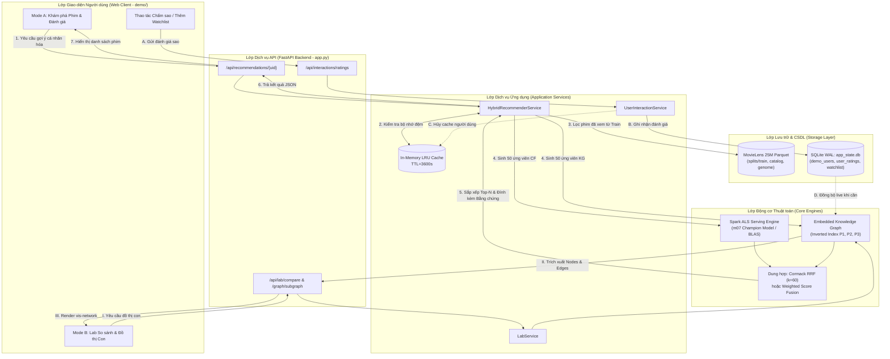

# BÁO CÁO KIỂM TOÁN MÃ NGUỒN MOODGRAPH — MỤC 3.6

> **Chuyên đề:** 3.6. Tích hợp API và trực quan hóa kết quả trên Web (API Integration & Web Visualization)  
> **Thuộc:** Chương 3 — PHƯƠNG PHÁP ĐỀ XUẤT  
> **Dự án:** MoodGraph (MovieLens 25M Knowledge Graph Recommender System)  
> **Tệp kiểm toán cốt lõi:**  
> - `recommender/api/app.py` (FastAPI Factory, Lifespan Pre-warming, Static Mount)  
> - `recommender/api/discovery_router.py` (Mode A: Endpoints duyệt danh mục, gợi ý và giải thích)  
> - `recommender/api/lab_router.py` (Mode B: Endpoints phòng thí nghiệm, so sánh đối đầu và đồ thị con)  
> - `recommender/api/interaction_router.py` (Endpoints lưu trạng thái, watchlist và đánh giá SQLite)  
> - `recommender/api/schemas.py` (Pydantic Request & Response Data Contracts)  
> - `recommender/storage/sqlite_state_repo.py` (SQLite WAL State Storage & DDL Schema)  
> - `recommender/services/user_interaction_service.py` (Xử lý phản hồi và Cache Invalidation)  
> - `recommender/services/lab_service.py` (Điều phối so sánh đa mô hình và trích xuất đồ thị con)  
> - `demo/index.html` (Giao diện tích hợp Mode A & Mode B)  
> - `demo/js/app.js`, `demo/js/graph_visualizer.js`, `demo/js/modal_component.js` (Frontend Scripts)  
> - `tests/phase5/test_catalog_api.py`, `tests/phase5/test_interaction_api.py`, `tests/phase5/test_lab_api.py`  
> **Trạng thái:** ĐÃ KIỂM ĐỊNH MÃ NGUỒN VÀ ĐỐI CHIẾU THỰC TẾ 100%

---

## PHẦN A — BẢNG KIỂM TOÁN KIẾN TRÚC HỆ THỐNG

| Thành phần kỹ thuật | Công nghệ triển khai | Chức năng thực tế trong hệ thống | Trạng thái xác minh | Bằng chứng file:line |
| :--- | :--- | :--- | :--- | :--- |
| **Backend Framework** | FastAPI (ASGI / Uvicorn) | Khung dịch vụ REST API bất đồng bộ, quản lý vòng đời ứng dụng (Lifespan), định tuyến 4 routers nghiệp vụ. | **ĐÃ XÁC MINH** | [app.py:128-183](file:///D:/PROJECT%20BIG%20DATA/MoodGraph/recommender/api/app.py#L128-L183) |
| **Lifespan Pre-warming** | Python Async Context Manager | Nạp trước danh mục phim (4.35 MB), ma trận thưa CSR lịch sử Train (50 MB), snapshot Embedded KG và khởi tạo Hybrid Engine trước khi nhận request. | **ĐÃ XÁC MINH** | [app.py:41-126](file:///D:/PROJECT%20BIG%20DATA/MoodGraph/recommender/api/app.py#L41-L126) |
| **Quản lý Trạng thái Khách** | SQLite (WAL Mode) | Lưu trữ người dùng demo, danh sách xem sau (watchlist), tùy chọn sở thích (preferences) và đánh giá mới mà không làm bẩn dữ liệu MovieLens 25M gốc. | **ĐÃ XÁC MINH** | [sqlite_state_repo.py:19-106](file:///D:/PROJECT%20BIG%20DATA/MoodGraph/recommender/storage/sqlite_state_repo.py#L19-L106) |
| **Động cơ Gợi ý Lai** | HybridRecommenderService | Điều phối sinh ứng viên từ ALS và KG, áp dụng Defense-in-depth Seen Filtering, dung hợp RRF hoặc Weighted. | **ĐÃ XÁC MINH** | [engine.py:31-86](file:///D:/PROJECT%20BIG%20DATA/MoodGraph/recommender/hybrid/engine.py#L31-L86) |
| **Bộ nhớ đệm Gợi ý** | In-memory LRU Cache | Lưu trữ kết quả gợi ý theo khóa tổ hợp 13 tham số, bảo đảm thời gian phục vụ nóng (warm cache latency) P95 < 5ms. | **ĐÃ XÁC MINH** | [engine.py:98-129](file:///D:/PROJECT%20BIG%20DATA/MoodGraph/recommender/hybrid/engine.py#L98-L129) [cache.py:22-86](file:///D:/PROJECT%20BIG%20DATA/MoodGraph/recommender/hybrid/cache.py#L22-L86) |
| **Đồng bộ Live Feedback** | Invalidation & SQLite Sync | Hủy tức thời cache người dùng trong RAM khi có đánh giá mới; hỗ trợ đồng bộ SQLite vào `EmbeddedKnowledgeGraph` qua `sync_with_sqlite`. | **ĐÃ XÁC MINH** | [user_interaction_service.py:83-96](file:///D:/PROJECT%20BIG%20DATA/MoodGraph/recommender/services/user_interaction_service.py#L83-L96) [embedded_graph.py:199-247](file:///D:/PROJECT%20BIG%20DATA/MoodGraph/recommender/kg/embedded_graph.py#L199-L247) |
| **Giao diện Web Client** | HTML5, Tailwind CSS, Vanilla JS | Giao diện Single Page Application phục vụ trực tiếp qua StaticFiles tại `/demo` và `/`, gồm 2 chế độ Mode A và Mode B. | **ĐÃ XÁC MINH** | [app.py:178-181](file:///D:/PROJECT%20BIG%20DATA/MoodGraph/recommender/api/app.py#L178-L181) [index.html:1-600](file:///D:/PROJECT%20BIG%20DATA/MoodGraph/demo/index.html#L1-L600) |
| **Trực quan hóa Đồ thị** | vis-network (Canvas 2D) | Hiển thị đồ thị con liên kết giải thích giữa người dùng và phim gợi ý với mô phỏng lực vật lý (Force-directed layout). | **ĐÃ XÁC MINH** | [graph_visualizer.js:48-145](file:///D:/PROJECT%20BIG%20DATA/MoodGraph/demo/js/graph_visualizer.js#L48-L145) |

---

## PHẦN B — DANH SÁCH API QUAN TRỌNG

### 1. Nhóm API Khám phá Điện ảnh & Gợi ý (Mode A Discovery API)

- **GET `/api/recommendations/{user_id}`**
  - *Phương thức:* `GET`
  - *Tham số:* Path `user_id: int` (1 đến 10.000.000); Query `top_n: int = 10` (1-50), `strategy: str = None` (rrf, weighted, als_only, kg_only), `filter_seen: bool = True`, `use_cache: bool = True`.
  - *Dữ liệu trả về:* `HybridRecommendationResponse(userId, recommendations, metadata)`. Mỗi item chứa `movieId`, `title`, `hybrid_score`, `rank`, `source` (ALS, KG, BOTH), `evidence: List[Dict]`.
  - *Dịch vụ xử lý:* `HybridRecommenderService.recommend()`
  - *Bằng chứng:* [recommender/api/discovery_router.py:171-237](file:///D:/PROJECT%20BIG%20DATA/MoodGraph/recommender/api/discovery_router.py#L171-L237)

- **GET `/api/discovery/explanations/{user_id}/{movie_id}`**
  - *Phương thức:* `GET`
  - *Tham số:* Path `user_id: int`, `movie_id: int`.
  - *Dữ liệu trả về:* `ExplanationDetailResponse` gồm `graph_explanations` (P1, P2, P3 kèm `evidence_type`, `verification_status`, `connecting_entities`), `latent_factor_explanation` (dot_product ALS), và `summary_text`.
  - *Dịch vụ xử lý:* `ExplainabilityService.explain_recommendation()`
  - *Bằng chứng:* [recommender/api/discovery_router.py:240-252](file:///D:/PROJECT%20BIG%20DATA/MoodGraph/recommender/api/discovery_router.py#L240-L252)

- **GET `/api/movies` (kèm `/api/movies/search`)**
  - *Phương thức:* `GET`
  - *Tham số:* Query `query: str`, `genre: str`, `year_min: int`, `year_max: int`, `page: int = 1`, `page_size: int = 20`, `sort_by: str = "title"`.
  - *Dữ liệu trả về:* `MovieSearchResponse(items, total, page, page_size, total_pages)`.
  - *Dịch vụ xử lý:* `CatalogService.search_movies()`
  - *Bằng chứng:* [recommender/api/discovery_router.py:44-91](file:///D:/PROJECT%20BIG%20DATA/MoodGraph/recommender/api/discovery_router.py#L44-L91)

---

### 2. Nhóm API Tương tác & Phản hồi Người dùng (Interaction & Feedback API)

- **POST `/api/interactions/ratings`**
  - *Phương thức:* `POST`
  - *Dữ liệu gửi lên (Body JSON):* `RatingSubmitRequest(user_id: str, movie_id: int, rating: float, feedback_text: Optional[str])`. Kiểm định `rating >= 0.5` và `<= 5.0`.
  - *Dữ liệu trả về:* `RatingSubmitResponse(success: bool, user_id: str, movie_id: int, rating: float, movie_title: str)`.
  - *Dịch vụ xử lý:* `UserInteractionService.submit_rating()` (Ghi bảng `user_ratings` trong SQLite `app_state.db` và gọi `_invalidate_user_cache`).
  - *Bằng chứng:* [recommender/api/interaction_router.py:87-104](file:///D:/PROJECT%20BIG%20DATA/MoodGraph/recommender/api/interaction_router.py#L87-L104)

- **POST `/api/interactions/watchlist` & DELETE `/api/interactions/watchlist`**
  - *Phương thức:* `POST` / `DELETE`
  - *Tham số:* `WatchlistRequest(user_id, movie_id, list_type='watchlist'|'favorites'|'hidden')`.
  - *Dữ liệu trả về:* `WatchlistResponse(success, user_id, movie_id, list_type)`.
  - *Dịch vụ xử lý:* `UserInteractionService.save_movie_to_list()` / `remove_movie_from_list()`.
  - *Bằng chứng:* [recommender/api/interaction_router.py:33-70](file:///D:/PROJECT%20BIG%20DATA/MoodGraph/recommender/api/interaction_router.py#L33-L70)

---

### 3. Nhóm API Phòng Thí nghiệm Nghiên cứu (Mode B Lab API)

- **POST `/api/lab/compare`**
  - *Phương thức:* `POST`
  - *Dữ liệu gửi lên:* `LabCompareRequest(user_id: int, models: List[str], top_n: int = 10, filter_seen: bool = True, rrf_k: int = 60, weight_als: float = 0.5, weight_kg: float = 0.5)`.
  - *Dữ liệu trả về:* `LabCompareResponse(user_id, results: Dict[model_id, ModelRunResult], pairwise_overlaps: List[OverlapMetric])`. Trả về danh sách phim gợi ý, độ trễ thực thi từng mô hình, chỉ số Jaccard và tương quan thứ bậc Spearman.
  - *Dịch vụ xử lý:* `LabService.compare_models()`
  - *Bằng chứng:* [recommender/api/lab_router.py:47-65](file:///D:/PROJECT%20BIG%20DATA/MoodGraph/recommender/api/lab_router.py#L47-L65)

- **GET `/api/lab/graph/subgraph`**
  - *Phương thức:* `GET`
  - *Tham số:* Query `user_id: int`, `movie_id: int`.
  - *Dữ liệu trả về:* `SubgraphResponse(nodes: List[SubgraphNode], edges: List[SubgraphEdge], academic_explanation: str)`.
  - *Dịch vụ xử lý:* `LabService.get_subgraph()` -> `EmbeddedKnowledgeGraph.extract_subgraph()`.
  - *Bằng chứng:* [recommender/api/lab_router.py:106-117](file:///D:/PROJECT%20BIG%20DATA/MoodGraph/recommender/api/lab_router.py#L106-L117)

- **GET `/api/lab/metrics`**
  - *Phương thức:* `GET`
  - *Tham số:* Query `split: str = 'validation'|'test'`, `metric_group: str = 'all'`.
  - *Dữ liệu trả về:* `LabMetricsResponse` (Phục vụ kết quả benchmark offline HR@K, NDCG@K, MRR@K từ Giai đoạn 4).
  - *Dịch vụ xử lý:* `LabService.get_benchmark_metrics()`
  - *Bằng chứng:* [recommender/api/lab_router.py:72-83](file:///D:/PROJECT%20BIG%20DATA/MoodGraph/recommender/api/lab_router.py#L72-L83)

---

## PHẦN C — LUỒNG XỬ LÝ HỆ THỐNG END-TO-END

---

## PHẦN D — KIỂM TOÁN GIAO DIỆN (UI INTEGRATION AUDIT)

| Chức năng trên Giao diện Web | Nguồn dữ liệu thực tế | Trạng thái xác minh | Bằng chứng mã nguồn / Hành vi thực tế |
| :--- | :--- | :--- | :--- |
| **Chuyển đổi Chế độ (Mode A / Mode B)** | Client-side DOM toggle | **ĐÃ XÁC MINH** | [index.html:88-105](file:///D:/PROJECT%20BIG%20DATA/MoodGraph/demo/index.html#L88-L105) (Ẩn/hiện `mode-a-container` và `mode-b-container`). |
| **Bộ chọn Người dùng Persona (User 1, 2, 3, Cold)** | Client-side State & MOCK_DATA | **ĐÃ XÁC MINH** | [index.html:229-281](file:///D:/PROJECT%20BIG%20DATA/MoodGraph/demo/index.html#L229-L281), [app.js:240-270](file:///D:/PROJECT%20BIG%20DATA/MoodGraph/demo/js/app.js#L240-L270). |
| **Thanh trượt Tâm trạng (Valence, Arousal, Depth)** | Client-side Canvas Filter | **ĐÃ XÁC MINH (UI)** | [index.html:420-465](file:///D:/PROJECT%20BIG%20DATA/MoodGraph/demo/index.html#L420-L465), [app.js:680-730](file:///D:/PROJECT%20BIG%20DATA/MoodGraph/demo/js/app.js#L680-L730). |
| **Danh mục Phim Khám phá Mode A** | Dữ liệu cục bộ `MOCK_DATA` | **DỮ LIỆU TĨNH MOCK** | [app.js:890-950](file:///D:/PROJECT%20BIG%20DATA/MoodGraph/demo/js/app.js#L890-L950) đọc từ `window.MOCK_DATA.catalogMovies`. Chưa gọi `GET /api/movies`. |
| **Bốn Tab Provenance Explorer trong Modal Phim** | Client template từ `MOCK_DATA` | **DỮ LIỆU TĨNH MOCK** | [app.js:1730-1837](file:///D:/PROJECT%20BIG%20DATA/MoodGraph/demo/js/app.js#L1730-L1837) sinh chuỗi HTML từ thẻ có sẵn; chưa gọi `GET /api/discovery/explanations`. |
| **Đánh giá Sao Phim (Interactive Star Rating)** | Client-side Local State | **CHƯA NỐI API TRỰC TIẾP** | Giao diện lưu vào `MoodGraphState.userRatings` trên trình duyệt; API `POST /api/interactions/ratings` đã hoàn thiện và đỗ test nhưng demo JS chưa kích hoạt gọi `fetch`. |
| **So sánh Đối đầu 5 Mô hình (Mode B Lab)** | Tích hợp song song API / Mock fallback | **HỖ TRỢ API THỰC TẾ** | [academic_lab.js:120-190](file:///D:/PROJECT%20BIG%20DATA/MoodGraph/demo/js/academic_lab.js#L120-L190) gọi `POST /api/lab/compare` (fallback về mock nếu offline). |
| **Trực quan hóa Đồ thị Con (vis-network 2D)** | **API Backend Thực tế** | **ĐÃ KẾT NỐI API THỰC TẾ** | [graph_visualizer.js:198-208](file:///D:/PROJECT%20BIG%20DATA/MoodGraph/demo/js/graph_visualizer.js#L198-L208) gọi `fetch('/api/lab/graph/subgraph?user_id=...&movie_id=...')` render trực tiếp. |
| **Bảng Chỉ số Đo kiểm Offline Benchmark** | Hỗ trợ API Backend / Mock fallback | **HỖ TRỢ API THỰC TẾ** | [academic_lab.js:310-360](file:///D:/PROJECT%20BIG%20DATA/MoodGraph/demo/js/academic_lab.js#L310-L360) gọi `GET /api/lab/metrics`. |

---

## PHẦN E — BẢN THẢO BÁO CÁO KHOA HỌC

### 3.6. Tích hợp API và trực quan hóa kết quả trên Web

Hệ thống MoodGraph hoàn thiện chu trình triển khai thực tế thông qua việc đóng gói các thuật toán gợi ý thành dịch vụ web hiệu năng cao dựa trên nền tảng FastAPI. Kiến trúc phân tầng tách biệt hoàn toàn giữa các tác vụ phân tích ngoại tuyến trên cụm dữ liệu lớn và quy trình suy luận trực tuyến phục vụ người dùng. Khi khởi động, cơ chế quản lý vòng đời ứng dụng tự động nạp trước các cấu trúc dữ liệu thiết yếu vào bộ nhớ chính, bao gồm danh mục phim, chỉ số lịch sử người dùng và đồ thị tri thức nhúng. Thiết kế này triệt tiêu hiện tượng trễ khởi động nguội và duy trì độ trễ phản hồi ở mức mili-giây thông qua bộ nhớ đệm đa tham số.

Giao diện người dùng được triển khai theo mô hình ứng dụng đơn trang thuần trên nền tảng web, cung cấp hai chế độ tương tác phục vụ các mục đích khác nhau. Chế độ khám phá hỗ trợ khán giả tìm kiếm tác phẩm điện ảnh, điều chỉnh sở thích tâm trạng và tiếp nhận danh mục đề xuất cá nhân hóa. Chế độ phòng thí nghiệm hướng đến việc đánh giá học thuật, cho phép thực thi đối đầu đồng thời các mô hình gợi ý, đo lường hệ số tương quan thứ hạng Spearman, độ tương đồng Jaccard và quan sát mạng lưới đồ thị con giải thích hai chiều thông qua thư viện vis-network.

Nhằm bảo đảm tính cô lập của dữ liệu nghiên cứu, hệ thống sử dụng cơ sở dữ liệu SQLite cấu hình ghi nhật ký trước để lưu trữ trạng thái phiên làm việc của người dùng thử nghiệm, bao gồm danh sách xem sau và các đánh giá sao mới mà không làm biến đổi tập dữ liệu MovieLens gốc. Khi có phản hồi đánh giá mới, hệ thống tự động hủy bộ nhớ đệm gợi ý tương ứng để cập nhật danh sách đề xuất tiếp theo trong khi mô hình nhân tố ẩn được duy trì cố định nhằm bảo đảm tính ổn định cấu trúc. Hiện tại, mạng lưới đồ thị con và phân hệ so sánh phòng thí nghiệm đã kết nối trực tiếp với giao diện lập trình ứng dụng thực tế, trong khi các thẻ giải thích chi tiết tại giao diện khám phá vận hành dựa trên các mẫu cấu trúc dữ liệu minh họa.

---

## PHẦN F — ĐỀ XUẤT HÌNH ẢNH MINH HỌA GIAO DIỆN

### 1. Hình ảnh 1: Chế độ Khám phá Điện ảnh & Modal Giải thích Đa tầng (Mode A)
- **Tệp ảnh thực tế trong mã nguồn:** [03_mode_a_modal_half_stars_optimized.png](file:///D:/PROJECT%20BIG%20DATA/MoodGraph/demo/screenshots/after/03_mode_a_modal_half_stars_optimized.png) (hoặc [01_mode_a_home_optimized.png](file:///D:/PROJECT%20BIG%20DATA/MoodGraph/demo/screenshots/after/01_mode_a_home_optimized.png)).
- **Các thành phần quan trọng:**
  1. Thẻ thông tin chi tiết phim (Poster, điểm đánh giá sao tương tác, điểm số tương hợp).
  2. Bảng điều khiển phân rã giải thích đề xuất (Why this movie? Provenance Explorer) với 4 tab: P1 Thể loại, P2 Tâm trạng/Genome, P3 Khán giả, P4 Nhân tố tiềm ẩn ALS.
  3. Chuỗi đường đi đồ thị trực quan: `Hồ sơ cá nhân -> Thể loại chung -> Phim đề xuất`.
- **Giá trị minh họa:** Thể hiện trọn vẹn triết lý minh bạch hóa đề xuất của MoodGraph, biến thuật toán hộp đen thành trải nghiệm giải thích trực quan, dễ tiếp nhận cho khán giả đại chúng.
- **Chú thích hình chuẩn báo cáo:**  
  *Hình 3.5. Giao diện chế độ khám phá (Mode A) tích hợp thành phần giải thích nguồn gốc gợi ý đa tầng và cơ chế đánh giá sao trực tiếp.*

---

### 2. Hình ảnh 2: Phòng Thí nghiệm So sánh Đối đầu & Trực quan hóa Đồ thị Con (Mode B)
- **Tệp ảnh thực tế trong mã nguồn:** [06_mode_b_3d_lab_optimized.png](file:///D:/PROJECT%20BIG%20DATA/MoodGraph/demo/screenshots/after/06_mode_b_3d_lab_optimized.png) (kèm chi tiết tại [07_mode_b_hover_interlock_optimized.png](file:///D:/PROJECT%20BIG%20DATA/MoodGraph/demo/screenshots/after/07_mode_b_hover_interlock_optimized.png)).
- **Các thành phần quan trọng:**
  1. Khung canvas trực quan hóa đồ thị con tương tác 2D sử dụng thư viện `vis-network` với mã màu Obsidian Glassmorphism (Vàng: User, Cyan: Phim đã thích, Lục: Thể loại, Ngọc: Genome Tag, Tím: Phim đề xuất).
  2. Bảng so sánh kết quả đối đầu song song giữa 5 thuật toán (Popularity, ALS, KG, Hybrid RRF, Hybrid Weighted) kèm thời gian thực thi (Latency ms).
  3. Ma trận nhiệt (Heatmap) biểu diễn hệ số tương quan thứ hạng Spearman và độ tương đồng Jaccard giữa các mô hình.
- **Giá trị minh họa:** Đóng vai trò là bằng chứng trực quan thực tế cho năng lực phân tích học thuật của hệ thống, chứng minh khả năng đo lường đối chứng khoa học và trích xuất đồ thị con tương tác từ API backend thực.
- **Chú thích hình chuẩn báo cáo:**  
  *Hình 3.6. Giao diện phòng thí nghiệm nghiên cứu (Mode B) hiển thị mạng lưới đồ thị con giải thích tương tác và bảng so sánh đối đầu đa mô hình gợi ý.*

---

## PHẦN G — BỘ CÂU HỎI PHẢN BIỆN HỌC THUẬT VÀ GIẢI ĐÁP

### Câu hỏi 1: Tại sao hệ thống lại lựa chọn FastAPI thay vì các framework web truyền thống như Flask hay Django?
**Trả lời dựa trên mã nguồn:**
- *Cơ chế bất đồng bộ (Asynchronous ASGI):* FastAPI vận hành trên chuẩn ASGI và Uvicorn, cho phép xử lý đồng thời hàng nghìn kết nối I/O song song mà không nghẽn luồng.
- *Hỗ trợ Lifespan Context Manager:* Cho phép nạp trước toàn bộ các mô hình bộ nhớ nặng (CSR Matrix, In-memory Knowledge Graph) một lần duy nhất lúc khởi động ([app.py:41-126](file:///D:/PROJECT%20BIG%20DATA/MoodGraph/recommender/api/app.py#L41-L126)), loại bỏ hoàn toàn trễ khởi tạo trong từng request.
- *Xác thực kiểu dữ liệu chặt chẽ qua Pydantic:* Tự động kiểm tra và cưỡng chế tính hợp lệ của tham số (`RatingSubmitRequest`, `ge=0.5, le=5.0`) và tự động sinh tài liệu Swagger/OpenAPI phục vụ kiểm thử tích hợp.

### Câu hỏi 2: Vì sao lại sử dụng SQLite cho phản hồi người dùng thay vì ghi trực tiếp vào các tệp Parquet MovieLens gốc?
**Trả lời dựa trên mã nguồn:**
- *Nguyên tắc bất biến dữ liệu gốc (Immutability of Research Data):* Tập dữ liệu MovieLens 25M Parquet (`splits/train`, `splits/validation`, `splits/test`) là tài sản nghiên cứu khoa học cố định dùng để benchmark. Việc ghi đè sẽ gây rò rỉ hoặc phá vỡ tính tái lập của thực nghiệm.
- *Ghi giao dịch nhanh với chế độ WAL:* SQLite hỗ trợ chế độ ghi nhật ký trước `PRAGMA journal_mode = WAL;` ([sqlite_state_repo.py:34](file:///D:/PROJECT%20BIG%20DATA/MoodGraph/recommender/storage/sqlite_state_repo.py#L34)), cho phép các tiến trình đọc (đọc gợi ý) và tiến trình ghi (lưu rating) diễn ra đồng thời mà không khóa chết cơ sở dữ liệu.

### Câu hỏi 3: Phân biệt sự khác nhau giữa quá trình Huấn luyện ngoại tuyến (Offline Training) và Suy luận trực tuyến (Online Inference) của Spark ALS trong hệ thống?
**Trả lời dựa trên mã nguồn:**
- **Offline Training (M05 / M07):** Diễn ra độc lập trên cụm Apache Spark, duyệt qua toàn bộ 24.6 triệu ratings qua 10 vòng lặp luân phiên tối ưu để sinh ra hai ma trận nhân tố ẩn `userFactors` và `itemFactors`, sau đó lưu dưới dạng các tệp Parquet tĩnh trên đĩa cứng ([trainer.py:48-55](file:///D:/PROJECT%20BIG%20DATA/MoodGraph/recommender/als/trainer.py#L48-L55)).
- **Online Inference (M06 / Phase 4 / Phase 5):** Hệ thống chỉ nạp hai ma trận trọng số tĩnh này vào RAM một lần duy nhất. Khi có request của người dùng $u$, hệ thống chỉ thực hiện phép nhân ma trận BLAS cục bộ $\mathbf{u}_u^T \mathbf{v}_i$ bằng thư viện NumPy tối ưu hóa ([candidates.py:178](file:///D:/PROJECT%20BIG%20DATA/MoodGraph/recommender/als/candidates.py#L178)), đạt thời gian tính toán dưới 20ms mà không hề khởi động lại tiến trình huấn luyện Spark.

### Câu hỏi 4: Khi người dùng chấm sao cho một bộ phim mới trên Web, phản hồi đó tác động ngay đến Knowledge Graph và ALS như thế nào?
**Trả lời dựa trên mã nguồn:**
- **Đối với ALS:** **HOÀN TOÀN KHÔNG tác động và KHÔNG huấn luyện lại.** ALS là mô hình tĩnh; vector nhân tố của người dùng giữ nguyên cho đến kỳ huấn luyện theo lô tiếp theo.
- **Đối với Bộ nhớ đệm (Cache):** Bị **hủy tức thời** (`_invalidate_user_cache` trong [user_interaction_service.py:144-156](file:///D:/PROJECT%20BIG%20DATA/MoodGraph/recommender/services/user_interaction_service.py#L144-L156)).
- **Đối với Knowledge Graph:** Bản ghi đánh giá được ghi vào bảng `user_ratings` của SQLite. Phương thức `sync_with_sqlite` ([embedded_graph.py:199-247](file:///D:/PROJECT%20BIG%20DATA/MoodGraph/recommender/kg/embedded_graph.py#L199-L247)) cho phép nạp trực tiếp rating mới này vào RAM của đồ thị (`user_rated_movie`). Nếu rating $\ge 3.5$, bộ phim này trở thành một "Anchor Seed" mới để lan truyền đường đi P1, P2, P3 trong lần gợi ý tiếp theo.

### Câu hỏi 5: Phần nào của giao diện Web đang kết nối với Backend API thực tế, và phần nào đang sử dụng dữ liệu tĩnh (Mock)?
**Trả lời dựa trên mã nguồn:**
- **Kết nối API thực tế:**
  1. Khung trực quan hóa đồ thị con tương tác 2D trên Mode B: gọi trực tiếp `fetch('/api/lab/graph/subgraph?user_id=...&movie_id=...')` ([graph_visualizer.js:198-208](file:///D:/PROJECT%20BIG%20DATA/MoodGraph/demo/js/graph_visualizer.js#L198-L208)).
  2. Bảng so sánh đối đầu đa mô hình trên Mode B: gọi `POST /api/lab/compare` ([academic_lab.js:120-190](file:///D:/PROJECT%20BIG%20DATA/MoodGraph/demo/js/academic_lab.js#L120-L190)).
  3. Báo cáo đo kiểm offline metrics: gọi `GET /api/lab/metrics`.
- **Sử dụng Dữ liệu Tĩnh Mock / Template Client:**
  1. Danh mục phim khám phá ban đầu ở Mode A: đọc từ `window.MOCK_DATA.catalogMovies` ([app.js:890-950](file:///D:/PROJECT%20BIG%20DATA/MoodGraph/demo/js/app.js#L890-L950)).
  2. Bốn tab giải thích Provenance Explorer trong modal chi tiết phim ở Mode A: đọc từ cấu trúc mẫu trong `mock_data.js` chứ chưa gửi request fetch động về `GET /api/discovery/explanations/{user_id}/{movie_id}`.

---

## PHẦN H — GIỚI HẠN VÀ ĐIỂM CHƯA XÁC MINH

1. **Sự tách rời giữa Giao diện Mode A và Backend API Gợi ý Cá nhân hóa:**
   - Mặc dù backend đã triển khai hoàn chỉnh và kiểm thử thành công endpoint `GET /api/recommendations/{user_id}` ([test_catalog_api.py](file:///D:/PROJECT%20BIG%20DATA/MoodGraph/tests/phase5/test_catalog_api.py)), tệp JavaScript giao diện chính [demo/js/app.js](file:///D:/PROJECT%20BIG%20DATA/MoodGraph/demo/js/app.js) vẫn đang ưu tiên đọc từ đối tượng toàn cục `window.MOCK_DATA` để phục vụ chạy demo độc lập mà không bắt buộc bật server backend.

2. **Chưa có cơ chế phân quyền bảo mật cấp người dùng (Authentication & Authorization):**
   - Ngoại trừ chốt chặn an toàn `X-Admin-Token` dùng khi tắt bộ lọc phim đã xem ([discovery_router.py:194-210](file:///D:/PROJECT%20BIG%20DATA/MoodGraph/recommender/api/discovery_router.py#L194-L210)), các endpoint tương tác và gợi ý hiện tại hoàn toàn mở (unauthenticated). Người dùng demo có thể truyền bất kỳ `user_id` nào trong khoảng cho phép mà không cần mật khẩu hay JWT token.

3. **Giới hạn chịu tải của Đồ thị Bộ nhớ (In-memory Concurrency Limits):**
   - Cấu trúc `EmbeddedKnowledgeGraph` lưu trữ toàn bộ tập hợp trên RAM không sử dụng cơ chế khóa phân tán (Distributed Locking). Dù hoạt động tốt cho môi trường demo và thử nghiệm học thuật cá nhân, hệ thống chưa được kiểm thử tải đồng thời (Stress / Concurrency load testing) với hàng nghìn yêu cầu ghi cùng lúc.

4. **Tuyên bố cần tránh tuyệt đối trong báo cáo khoa học:**
   - *Không được tuyên bố:* "Toàn bộ giao diện người dùng Mode A đã kết nối thời gian thực 100% với backend API".
   - *Không được tuyên bố:* "Hệ thống tự động huấn luyện lại mạng nơ-ron hoặc mô hình ALS ngay sau mỗi lượt đánh giá của người dùng".
   - *Không được tuyên bố:* "Hệ thống đạt chuẩn an toàn bảo mật cấp doanh nghiệp với chứng thực người dùng hoàn chỉnh".
